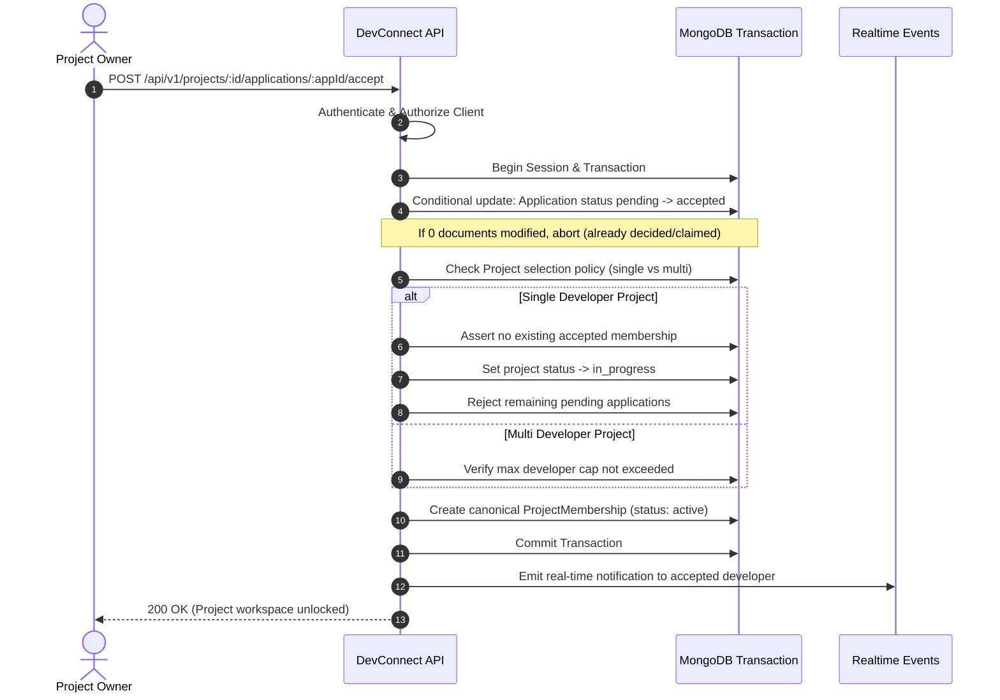
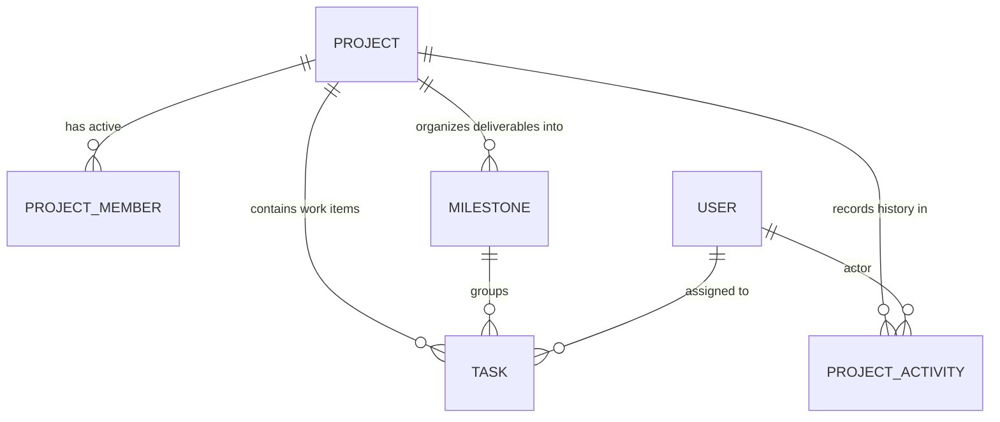
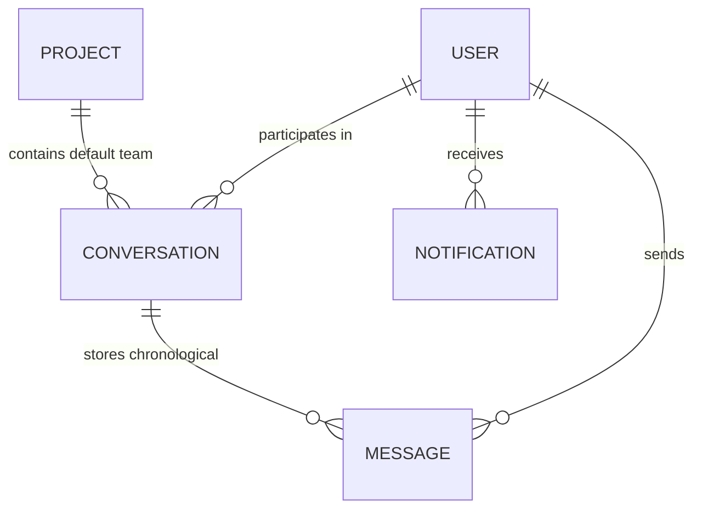

# DevConnect Architecture Documentation

## 1. System Overview

**DevConnect** is a developer–client community platform and project marketplace connecting students, engineers, freelancers, startups, and enterprise clients to collaborate, build, and deliver software projects.

The platform architecture follows a **Modular Monolith** pattern:
- **Frontend**: Single-page application built with React, Vite, TailwindCSS, and TypeScript.
- **Backend**: Express.js REST API and Socket.IO server built with Node.js and TypeScript.
- **Database**: MongoDB with Mongoose ODM supporting document storage, unique indexes, and multi-document transactions.
- **Validation**: Zod schema validation for runtime configuration, request bodies, query parameters, and route parameters.
- **Realtime**: Socket.IO for authenticated bidirectional events (messaging, notifications, project updates).

```
+--------------------------------------------------------------------------+
|                              Client (Web)                                |
|                   React 18 + Vite + TailwindCSS + TS                     |
+--------------------------------------------------------------------------+
                                     |
               HTTP/REST (v1)        |        WebSockets (WSS)
                                     v
+--------------------------------------------------------------------------+
|                        DevConnect Backend Engine                         |
|                   Express.js + Socket.IO + TypeScript                    |
|                                                                          |
|  +--------------------+  +---------------------+  +-------------------+  |
|  | Config & Env (Zod) |  | Security & Auth     |  | Central Errors    |  |
|  +--------------------+  +---------------------+  +-------------------+  |
|                                                                          |
|  +--------------------------------------------------------------------+  |
|  | Modules                                                            |  |
|  | - Auth         - Users       - Profiles      - Companies           |  |
|  | - Projects     - Apply       - Memberships   - Tasks               |  |
|  | - Milestones   - Payments    - Conversations - Community           |  |
|  | - Notifications                                                    |  |
|  +--------------------------------------------------------------------+  |
+--------------------------------------------------------------------------+
                                     |
                                     v
+--------------------------------------------------------------------------+
|                         MongoDB Database Cluster                         |
|               Replica Set / Atlas (ACID Transactions & Indexes)           |
+--------------------------------------------------------------------------+
```

---

## 2. Backend Modular Structure

The backend is organized into clear domain modules with separated concerns:

```
server/
  src/
    config/
      env.ts             # Runtime environment validation via Zod
      database.ts        # Resilient MongoDB connection manager
    middleware/
      authenticate.ts    # Session and JWT token authentication
      authorize.ts       # Role and policy-based permission gates
      validate.ts        # Zod request schema validation middleware
      errorHandler.ts    # Centralized operational & system error handler
      notFound.ts        # 404 handler for unmatched routes
      rateLimiter.ts     # Rate limiting for auth & sensitive routes
    models/              # Canonical Mongoose schemas & indexes
    modules/             # Domain modules (routes, controller, service, policies)
      auth/
      users/
      profiles/
      companies/
      projects/
      applications/
      memberships/
      tasks/
      milestones/
      payments/
      conversations/
      community/
      notifications/
    policies/            # Reusable authorization rules (owners, members, admins)
    services/            # Cross-cutting infrastructure services (mailer, upload)
    sockets/             # Authenticated Socket.IO room and message handlers
    utils/               # Logger, date helpers, custom error classes
    app.ts               # Express application pipeline setup
    server.ts            # HTTP server, socket bootstrap & graceful shutdown
  tests/
    unit/                # Pure unit tests (validation, domain rules)
    integration/         # API endpoints & database integration tests
    security/            # Access control, NoSQL injection & rate limiting tests
    fixtures/            # Deterministic seed data & mock factories
  .env.example           # Documented environment variable template
  package.json
  tsconfig.json
```

Each domain module implements:
- **Routes**: REST endpoints under `/api/v1/*`.
- **Validation Schema**: Strict Zod schemas for `body`, `query`, and `params`.
- **Controller**: Thin request parsing and status code dispatch.
- **Service**: Business logic, transaction orchestration, and audit trails.
- **Policy**: Server-side access control checks.

---

## 3. Data Model & Integrity Invariants

### Canonical Entities

1. **User**: Name, normalized email, password hash, account type, roles, verification timestamp, status.
2. **Profile**: 1-to-1 with User. Headline, bio, skills, education, portfolio, availability.
3. **Company**: Name, description, website, owner reference, verification status.
4. **CompanyMember**: Unique compound index `[company, user]`. Company role (Owner, Admin, Member).
5. **Project**: Title, description, owner type (`User` or `Company`), budget, pricing model (fixed/hourly), single or multi-developer selection mode, deadline, status (`draft`, `open`, `in_progress`, `completed`, `cancelled`).
6. **Application**: Unique compound index `[project, applicant]`. Proposal text, proposed amount, estimated delivery, status (`pending`, `shortlisted`, `accepted`, `rejected`, `withdrawn`).
7. **ProjectMembership**: Unique compound index `[project, user]`. Enforces exact active project access.
8. **Task**: Scoped to project. Assignee, title, status (`todo`, `in_progress`, `in_review`, `completed`), due date.
9. **Milestone**: Scoped to project. Amount, deliverable status (`pending`, `submitted`, `approved`), funding status (`unfunded`, `held_in_escrow`, `released`, `refunded`).
10. **PaymentRecord**: Idempotency key, transaction ID, milestone reference, payer, payee, provider, status.
11. **Conversation & Message**: Separate collections. Conversations tracks participants; Messages contains text, timestamps, attachments, sender.
12. **CommunityPost & Comment**: Public discussions separate from private project workspaces.
13. **Notification**: Recipient, event type, entity reference, read status.

---

## 4. Critical Business Invariant: Atomic Application Acceptance

The core marketplace transaction is **Accepting an Application**:



**Guarantees**:
- Conditional write prevents race conditions: two clients or simultaneous clicks cannot accept competing developers on a single-selection project.
- Rollback on failure: if membership creation fails, application state is not mutated.
- Authoritative backend: frontend state does not decide access.

---

## 5. Security Architecture

1. **Authentication**: Cookie-based HttpOnly JWT tokens or access/refresh token rotation.
2. **Authorization**: Independent policy evaluation per resource. Applicants cannot access workspace until accepted. Unrelated users cannot read tasks, milestones, or messages.
3. **Input Sanitization & NoSQL Injection Defense**: Strict Zod validation strips undeclared fields. ObjectIds are validated before any MongoDB query.
4. **Environment Isolation**: `.env.example` contains zero secrets. Runtime crashes fast if required variables are missing or malformed.
5. **CORS & Headers**: Strict CORS origin matching the frontend client URL, disabled in-browser credentials leaks, standard security headers.

---

## 6. Implementation Phases

- **Phase 1 (Completed)**: Foundation setup, environment validation, database connection resilience, centralized error handling, and health endpoint.
- **Phase 2 (Completed)**: Authentication & User Profiles:
  - Canonical `User` model with normalized email/username, unique indexes, passwordHash isolation.
  - `RefreshSession` model with token hashing and automatic TTL cleanup.
  - Token strategy: short-lived access tokens (`15m`) and secure HTTP-only refresh tokens (`7d`).
  - Modular architecture: `src/modules/auth/` and `src/modules/users/`.
  - Rate limiting middleware with sliding window.
  - Endpoints: `POST /api/v1/auth/register`, `POST /api/v1/auth/login`, `GET /api/v1/auth/me`, `POST /api/v1/auth/logout`, `POST /api/v1/auth/refresh`, `PATCH /api/v1/auth/change-password`, `GET /api/v1/users/:username`, `PATCH /api/v1/users/me`.
  - Automated integration test suite covering 20 security invariants.
- **Phase 3 (Next)**: Projects and Applications:
  - Clients create and publish projects with budgets and skill tags.
  - Developers discover open projects and submit proposals.
  - Application review and transactional acceptance workflow.
- **Phase 4**: Project memberships, workspace security, tasks, and milestone records.
- **Phase 5**: Real-time Socket.IO chat, notifications, and community modules.
- **Phase 6**: Payment gateway boundaries, escrow ledger, and webhook verification.
- **Phase 7**: CI pipeline, security review, and production hardening.

---

## 7. Phase 2 API Specification & Schemas

### Authentication Endpoints

#### 1. Register User
- **Method & Route**: `POST /api/v1/auth/register`
- **Rate Limit**: 20 requests / 15 minutes
- **Request Body**:
  ```json
  {
    "name": "Jane Developer",
    "username": "janedev",
    "email": "jane@example.com",
    "password": "Password123!",
    "role": "developer",
    "bio": "Full-stack engineer",
    "skills": ["React", "Node.js", "TypeScript"]
  }
  ```
- **Response** (`201 Created`):
  ```json
  {
    "success": true,
    "message": "User registered successfully",
    "data": {
      "user": {
        "_id": "671aa...",
        "name": "Jane Developer",
        "username": "janedev",
        "email": "jane@example.com",
        "role": "developer",
        "skills": ["React", "Node.js", "TypeScript"],
        "isEmailVerified": false,
        "isActive": true
      },
      "accessToken": "eyJhbGciOi...",
      "token": "eyJhbGciOi...",
      "expiresIn": "15m"
    }
  }
  ```
- **Cookies**: `accessToken` (15m, HttpOnly), `refreshToken` (7d, HttpOnly).

#### 2. Login User
- **Method & Route**: `POST /api/v1/auth/login`
- **Rate Limit**: 20 requests / 15 minutes
- **Request Body**:
  ```json
  {
    "identifier": "janedev", // Or "email": "jane@example.com"
    "password": "Password123!"
  }
  ```
- **Response** (`200 OK`):
  ```json
  {
    "success": true,
    "message": "Login successful",
    "data": {
      "user": { ...safeUser },
      "accessToken": "eyJhbGciOi...",
      "token": "eyJhbGciOi...",
      "expiresIn": "15m"
    }
  }
  ```
- **Error Responses**:
  - `401 Unauthorized`: `{"success": false, "error": {"code": "UNAUTHORIZED", "message": "Invalid email, username, or password"}}`
  - `403 Forbidden`: `{"success": false, "error": {"code": "FORBIDDEN", "message": "Account is deactivated. Please contact support."}}`

#### 3. Current Authenticated User
- **Method & Route**: `GET /api/v1/auth/me`
- **Headers**: `Authorization: Bearer <accessToken>` or `Cookie: accessToken=<jwt>`
- **Response** (`200 OK`):
  ```json
  {
    "success": true,
    "data": {
      "user": { ...safeUser }
    }
  }
  ```

#### 4. Logout
- **Method & Route**: `POST /api/v1/auth/logout`
- **Response** (`200 OK`):
  ```json
  {
    "success": true,
    "message": "Logged out successfully"
  }
  ```
- **Action**: Invalidates refresh session in database, clears `accessToken`, `token`, and `refreshToken` cookies.

#### 5. Change Password
- **Method & Route**: `PATCH /api/v1/auth/change-password`
- **Headers**: `Authorization: Bearer <accessToken>`
- **Request Body**:
  ```json
  {
    "currentPassword": "Password123!",
    "newPassword": "NewSecurePassword456!"
  }
  ```
- **Response** (`200 OK`):
  ```json
  {
    "success": true,
    "message": "Password changed successfully. Please log in again with your new credentials."
  }
  ```

---

### User Profile Endpoints

#### 1. Public Profile Retrieval
- **Method & Route**: `GET /api/v1/users/:username`
- **Access**: Public
- **Response** (`200 OK`):
  ```json
  {
    "success": true,
    "data": {
      "profile": {
        "_id": "671aa...",
        "name": "Jane Developer",
        "username": "janedev",
        "role": "developer",
        "avatarUrl": "https://...",
        "bio": "Full-stack engineer",
        "skills": ["React", "Node.js", "TypeScript"],
        "createdAt": "2026-10-24T19:00:00.000Z"
      }
    }
  }
  ```
- **Security**: Never exposes email, passwordHash, isEmailVerified, isActive, or internal tokens.

#### 2. Update Own Profile
- **Method & Route**: `PATCH /api/v1/users/me`
- **Headers**: `Authorization: Bearer <accessToken>`
- **Request Body**:
  ```json
  {
    "name": "Jane Senior Architect",
    "bio": "Updated bio...",
    "skills": ["React 19", "Node.js", "MongoDB", "Kubernetes"]
  }
  ```
- **Security Invariant**: Strictly scoped to authenticated `req.userId`. Attempting to inject `_id`, `role`, `passwordHash`, or `isEmailVerified` is stripped automatically, preventing mass assignment and role escalation.

---

## 9. Phase 3: Projects & Applications Backend

### 1. Project Domain Model
The `Project` model represents client-published initiatives and engineering contracts.

- **Primary Fields**:
  - `title`: String (3–120 characters, trimmed)
  - `slug`: String (unique, URL-friendly slug with entropy suffix fallback)
  - `description`: String (minimum 10 characters)
  - `shortDescription`: String (trimmed summary)
  - `ownerId` / `owner`: ObjectId ref `User` (strictly derived from authenticated session)
  - `skillsRequired` / `requiredSkills`: Array of Strings (indexed)
  - `category`: String (indexed, e.g., Web Development, DevOps, Mobile)
  - `difficulty`: Enum (`beginner`, `intermediate`, `advanced`)
  - `projectType`: Enum (`paid`, `unpaid`, `collaboration`)
  - `budgetMin` / `budgetMax`: Non-negative numbers with `budgetMax >= budgetMin` validation
  - `currency`: 3-letter ISO code (default: `USD`)
  - `applicationDeadline`: Optional Date (applications rejected once expired)
  - `visibility`: Enum (`public`, `private`)
  - `status`: Enum (`draft`, `open`, `in_progress`, `completed`, `cancelled`)
  - `maxTeamSize`: Positive integer (default: `1`)
  - `applications`: Array of ObjectId ref `Application`
  - `isArchived`: Boolean (default: `false`, enables safe soft-deletion)

- **Database Indexes**:
  - `slug: 1` (unique: true, sparse: true)
  - `ownerId: 1`, `owner: 1`
  - `status: 1`, `category: 1`, `skillsRequired: 1`
  - `{ status: 1, visibility: 1, isArchived: 1 }` (compound index for fast feed filtering)

---

### 2. Application Domain Model
The `Application` model represents developer proposals and bids for projects.

- **Primary Fields**:
  - `projectId` / `project`: ObjectId ref `Project`
  - `applicantId` / `applicant`: ObjectId ref `User` (strictly derived from authentication)
  - `proposal` / `coverLetter`: String (10–3000 characters)
  - `proposedBudget` / `proposedRate`: Optional numeric bid or rate string
  - `estimatedDuration`: String (estimated turnaround)
  - `status`: Enum (`pending`, `accepted`, `rejected`, `withdrawn`)
  - `decidedAt`: Timestamp of decision
  - `decisionReason`: Optional rejection explanation or feedback
  - `withdrawnAt`: Timestamp of applicant withdrawal

- **Database-Level Integrity**:
  - Compound unique index: `{ projectId: 1, applicantId: 1 }` (unique: true)
  - Guarantees at the database engine level that no user can submit duplicate applications for the same project.

---

### 3. Application Status State Machine

```
              +------------+
              |  pending   |
              +------------+
                /    |    \
     (Withdraw)/     |     \(Accept)
              v      |      v
      +-----------+  |  +------------+
      | withdrawn |  |  |  accepted  |  ---> [Phase 4: Workspace & Membership]
      +-----------+  |  +------------+
                     v
               +------------+
               |  rejected  |
               +------------+
```

- **Transitions**:
  - `pending` -> `accepted` (Project owner only; capacity check enforced)
  - `pending` -> `rejected` (Project owner only)
  - `pending` -> `withdrawn` (Applicant only)
  - Terminal states (`accepted`, `rejected`, `withdrawn`) cannot transition.

---

### 4. Concurrency Safety & Team Capacity
For single-developer and multi-developer projects:
- **Single Developer (`maxTeamSize: 1`)**:
  - Atomic conditional update: `Application.findOneAndUpdate({ _id, status: 'pending' }, { $set: { status: 'accepted' } })`.
  - Atomically marks project status as `in_progress` once accepted.
  - Two concurrent requests cannot both succeed; only the first matching `status: 'pending'` commits.
- **Multiple Developers (`maxTeamSize > 1`)**:
  - Capacity check: `currentAcceptedCount = countDocuments({ projectId, status: 'accepted' })`.
  - Rejects acceptance if `currentAcceptedCount >= maxTeamSize`.

---

### 5. Projects & Applications API Contracts

| Method | Endpoint | Access | Description |
| :--- | :--- | :--- | :--- |
| `POST` | `/api/v1/projects` | Client / Company | Create a project; owner derived from session |
| `GET` | `/api/v1/projects` | Public / Guest | Browse open projects with pagination & filters |
| `GET` | `/api/v1/projects/mine` | Authenticated | List all projects owned by authenticated user |
| `GET` | `/api/v1/projects/:projectId` | Public / Owner | Retrieve project details (private projects owner-only) |
| `PATCH` | `/api/v1/projects/:projectId` | Owner | Update allowlisted project fields |
| `DELETE` | `/api/v1/projects/:projectId` | Owner | Soft delete / archive project |
| `POST` | `/api/v1/projects/:projectId/applications` | Developer / Freelancer | Submit an application to an open project |
| `GET` | `/api/v1/projects/:projectId/applications` | Project Owner | List applications with applicant profiles |
| `GET` | `/api/v1/applications/mine` | Authenticated | View own application history & statuses |
| `GET` | `/api/v1/applications/:applicationId` | Applicant / Owner | View single application details |
| `PATCH` | `/api/v1/applications/:applicationId/withdraw` | Applicant | Withdraw a pending application |
| `PATCH` | `/api/v1/applications/:applicationId/decision` | Project Owner | Accept or reject a pending application |

---

### 6. Phase 4 Implementation & Integration
When an application is accepted:
1. Status transitions atomically to `accepted`.
2. Safe notification is dispatched to the developer.
3. If project capacity is reached, project transitions to `in_progress`.
4. The accepted applicant is automatically provisioned as a `ProjectMember` with role `'member'` and status `'active'`.
5. The project owner is ensured an active membership with role `'owner'`.
6. Audit entries (`APPLICATION_ACCEPTED`, `MEMBER_ADDED`) are recorded in `ProjectAuditLog`.

---

## 10. Phase 4: Project Membership & Secure Workspace Access

### 1. Project Membership Domain Model
The `ProjectMember` model governs team participation and role-based permissions inside a project workspace.

- **Primary Fields**:
  - `projectId`: ObjectId ref `Project` (required, indexed)
  - `userId`: ObjectId ref `User` (required, indexed)
  - `role`: Enum (`owner`, `maintainer`, `member`)
  - `status`: Enum (`active`, `removed`, `left`)
  - `joinedAt`: Date (timestamp of joining or reactivating)
  - `removedAt`: Date (optional, timestamp of soft removal)
  - `leftAt`: Date (optional, timestamp of voluntary departure)
  - `addedBy`: ObjectId ref `User` (actor who added or accepted the member)
  - `createdAt`, `updatedAt`

- **Database-Level Integrity**:
  - Compound unique index: `{ projectId: 1, userId: 1 }` (unique: true)
  - Single document per user per project; status transitions govern rejoining/reactivation without duplicating records.
  - Query indexes: `{ projectId: 1, status: 1 }`, `{ userId: 1, status: 1 }`.

---

### 2. Workspace Access Policy & Hierarchy

```
    Role Hierarchy:
    [ owner ]       -> Weight: 3  (Full authority: settings, deletion, role updates, member removal)
        |
    [ maintainer ]  -> Weight: 2  (Team management: remove standard members, manage tasks & milestones)
        |
    [ member ]      -> Weight: 1  (Workspace collaboration: tasks, files, discussions)
```

- **Policy**: `WorkspacePolicy.checkWorkspaceAccess(userId, projectId, requiredRole)`
- **Express Middleware**:
  - `requireWorkspaceMember`: Permits `member`, `maintainer`, and `owner`.
  - `requireWorkspaceMaintainer`: Permits `maintainer` and `owner`.
  - `requireWorkspaceOwner`: Strictly permits `owner`.
- **Enforcement Rules**:
  - Only active members (`status: 'active'`) and project owners can enter the workspace.
  - Rejected applicants, removed members, and unrelated users receive `403 Forbidden`.
  - Removed members lose workspace access immediately on their next request.

---

### 3. Member Management Rules & Safety Invariants
- **Member Removal (`DELETE /projects/:projectId/members/:userId`)**:
  - Owners can remove any member or maintainer.
  - Maintainers can remove standard members, but CANNOT remove owners or fellow maintainers.
  - Standard members cannot remove anyone.
  - An owner cannot remove themselves if they are the sole owner (prevents project orphaning).
  - Removal is soft (`status: 'removed'`, `removedAt: Date`).
- **Voluntary Leave (`POST /projects/:projectId/leave`)**:
  - Active members can leave voluntarily (`status: 'left'`, `leftAt: Date`).
  - Sole project owners cannot leave or orphan the project.
- **Role Updates (`PATCH /projects/:projectId/members/:userId/role`)**:
  - Strictly owner-only.
  - Allows assigning `maintainer` or `member` roles.
  - Members cannot self-promote.

---

### 4. Socket.IO Project Room Authorization
- Project workspace rooms are secured via the `join_project_workspace` event in `server.ts`.
- Before joining room `project:${projectId}`, the socket server calls `WorkspacePolicy.checkWorkspaceAccess(userId, projectId, 'member')`.
- Unauthorized sockets (rejected, removed, or unrelated users) receive an explicit `workspace_error` event and room access is rejected.

---

### 5. Phase 4 API Contracts

| Method | Endpoint | Access | Description |
| :--- | :--- | :--- | :--- |
| `GET` | `/api/v1/projects/:projectId/members` | Owner / Active Members | List active team members with safe user profiles |
| `GET` | `/api/v1/projects/:projectId/members/:userId` | Owner / Active Members | View specific member details and role |
| `DELETE` | `/api/v1/projects/:projectId/members/:userId` | Owner / Maintainer | Soft-remove a member from the project team |
| `PATCH` | `/api/v1/projects/:projectId/members/:userId/role` | Project Owner | Promote or demote member (`maintainer` / `member`) |
| `POST` | `/api/v1/projects/:projectId/leave` | Active Member | Voluntarily leave project team |
| `GET` | `/api/v1/memberships/mine` | Authenticated | List all active project memberships for user |
| `GET` | `/api/v1/projects/:projectId/workspace` | Owner / Active Members | Access secure project workspace resources |

---

### 6. Phase 5: Tasks, Milestones & Collaboration Workflow

Phase 5 builds directly upon Phase 4 workspace authorization to deliver an end-to-end task and milestone collaboration system.

#### 1. Collaboration Data Models



1. **`Task` (`server/src/models/Task.ts`)**:
   - `projectId` (ObjectId, indexed): Strict project containment.
   - `title`, `description`, `status` (`todo`, `in_progress`, `in_review`, `completed`, `blocked`, `cancelled`).
   - `priority` (`low`, `medium`, `high`, `urgent`).
   - `assigneeIds` (`ObjectId[]`): Array of validated active `ProjectMember` references.
   - `createdBy` (`ObjectId`): Set from authenticated user.
   - `milestoneId` (`ObjectId`, optional): Must belong to the exact same project.
   - `dueDate`, `estimatedHours`, `labels`, `position`.
   - `completedAt`, `submittedForReviewAt`, `reviewFeedback`.
   - `isArchived`: Boolean soft deletion flag.

2. **`Milestone` (`server/src/models/Milestone.ts`)**:
   - `projectId` (ObjectId, indexed): Strict single-project scope.
   - `title`, `description`, `status` (`upcoming`, `in_progress`, `completed`, `cancelled`).
   - `dueDate`, `position`, `createdBy`, `completedAt`, `isArchived`.
   - Financial attributes are cleanly decoupled from deliverable completion status.

3. **`ProjectActivity` (`server/src/models/ProjectActivity.ts`)**:
   - `projectId`, `actorId`, `entityType` (`task`, `milestone`, `member`, `project`), `entityId`, `action`, `metadata`, `createdAt`.
   - Trusted service generation only; client forgery is prohibited.
   - Emits real-time Socket.IO broadcasts to `project:${projectId}` workspace rooms.

---

#### 2. Task State Machine & Review Gate

The task lifecycle enforces an explicit state machine preventing arbitrary CRUD status jumps:

```
                  +---------------------------+
                  |           todo            |
                  +---------------------------+
                              |         ^
                 start work   |         | reopen
                              v         |
     +--------------> +---------------------------+ <---------------+
     |                |        in_progress        |                 |
     |                +---------------------------+                 |
     |                     |         ^        ^                     |
     |             unblock |         | block  | changes requested   |
     |                     v         |        |                     |
     |                +-----------------+     |                     |
     |                |     blocked     |     |                     |
     |                +-----------------+     |                     |
     |                                        |                     |
     |       submit for review                |                     |
     |       (assignee or maintainer)         |                     |
     |                     +---------------------------+            |
     +-------------------- |         in_review         | -----------+
                           +---------------------------+
                                         |
                                         | approve review
                                         | (owner or maintainer ONLY)
                                         v
                           +---------------------------+
                           |         completed         |
                           +---------------------------+
```

**Security Invariants**:
- **Self-Approval Guard**: Ordinary members cannot approve tasks in review (`403 Forbidden`). Only maintainers or project owners may approve work.
- **Timestamp Integrity**: `completedAt` is automatically set on completion and cleared when a completed task is reopened.
- **Review Feedback**: Review feedback is captured on `TASK_CHANGES_REQUESTED` and returned to assignees with notification alerts.
- **Archival over Destruction**: Tasks and milestones are archived (`isArchived: true`) to preserve historical activity records and metrics.

---

#### 3. Milestone Anti-Orphan Invariant

- A milestone cannot be deleted if active tasks reference it (`Task.countDocuments({ milestoneId, isArchived: false }) > 0`).
- The API rejects the deletion with `400 Bad Request` and instructs the caller to reassign or complete linked tasks first.
- Linking a task to a milestone belonging to another project is strictly prohibited by cross-project verification.

---

#### 4. Phase 5 API Contracts

| Method | Endpoint | Access | Description |
| :--- | :--- | :--- | :--- |
| `POST` | `/api/v1/projects/:projectId/tasks` | Maintainer / Owner | Create task with validated assignees & milestone |
| `GET` | `/api/v1/projects/:projectId/tasks` | Active Member | List project tasks with pagination, filtering, & sorting |
| `GET` | `/api/v1/projects/:projectId/tasks/:taskId` | Active Member | Single task details with safe creator & assignee data |
| `PATCH` | `/api/v1/projects/:projectId/tasks/:taskId` | Assignee / Maintainer | Update allowlisted task fields |
| `PUT` | `/api/v1/projects/:projectId/tasks/:taskId/assignees` | Maintainer / Owner | Explicitly update task assignees |
| `PATCH` | `/api/v1/projects/:projectId/tasks/:taskId/status` | Active Member | Advance status through state machine & review gates |
| `DELETE` | `/api/v1/projects/:projectId/tasks/:taskId` | Maintainer / Owner | Archive / soft-delete task |
| `GET` | `/api/v1/tasks/mine` | Authenticated User | List tasks assigned to current user across projects |
| `POST` | `/api/v1/projects/:projectId/milestones` | Maintainer / Owner | Create project deliverable milestone |
| `GET` | `/api/v1/projects/:projectId/milestones` | Active Member | List milestones with task completion statistics |
| `GET` | `/api/v1/projects/:projectId/milestones/:milestoneId` | Active Member | Get milestone details and progress stats |
| `PATCH` | `/api/v1/projects/:projectId/milestones/:milestoneId` | Maintainer / Owner | Update milestone fields and status |
| `DELETE` | `/api/v1/projects/:projectId/milestones/:milestoneId` | Maintainer / Owner | Delete milestone (enforces anti-orphan invariant) |
| `GET` | `/api/v1/projects/:projectId/progress` | Active Member | Authoritative task breakdown and progress metrics |
| `GET` | `/api/v1/projects/:projectId/activity` | Active Member | Paginated project activity history feed |

---

### 7. Phase 6: Real-Time Chat, Notifications & Project Communication

Phase 6 implements persistent, secure messaging and in-app notifications tied to the project workspace and authentication system.

#### 1. Communication Data Models



1. **`Conversation` (`server/src/models/Conversation.ts`)**:
   - `type`: `'project' | 'direct'`.
   - `projectId`: References `Project`. Guarded by compound unique index `{ projectId: 1, type: 1 }` to guarantee exactly one default team conversation per project.
   - `participantIds`: References to active members and project owners.
   - `lastMessage`, `lastMessageAt`, `lastMessageSenderId`: Denormalized conversation previews for performant sidebar listing.
   - `readStates`: Per-user tracking storing `{ userId, lastReadMessageId, lastReadAt }`.
   - `isArchived`: Boolean flag preserving history.

2. **`Message` (`server/src/models/Message.ts`)**:
   - `conversationId`: Scoped to conversation (indexed).
   - `projectId`: Optional project scoping for workspace messages.
   - `senderId`: Authenticated user ID (strictly server-derived; client values ignored).
   - `content`: Trimmed text (1–5000 characters).
   - `contentType`: `'text' | 'code' | 'system' | 'image' | 'file'`.
   - `attachments`: File metadata references (`name`, `url`, `fileType`, `fileSize`).
   - `isEdited`, `editedAt`: Edit audit trail (sender-only).
   - `isDeleted`, `deletedAt`, `deletedForEveryone`: Soft deletion preserving thread integrity.
   - `readBy`: Array of user IDs who have seen the message.

3. **`Notification` (`server/src/models/Notification.ts`)**:
   - `recipient`: Indexed target user.
   - `actorId`: Triggering user.
   - `title`, `message`, `type` (`info`, `success`, `warning`, `alert`).
   - `resourceType`, `resourceId`: Linked project or conversation reference.
   - `read`, `readAt`: Read status tracking.

---

#### 2. Socket.IO Authentication & Secure Room Hierarchy

```
                   Client Connection (Handshake)
                               |
                   JWT Verification (Cookie / Auth Token)
                               |
                 +-------------+-------------+
                 |                           |
             [Invalid]                   [Valid]
                 |                           |
         Reject Handshake            Attach socket.data.user
                                     Join Room: user:<userId>
                                             |
                  +--------------------------+--------------------------+
                  |                                                     |
        conversation:join                                         project:join
                  |                                                     |
      Verify Workspace Access                               Verify Workspace Access
      (WorkspacePolicy.checkWorkspaceAccess)                (WorkspacePolicy.checkWorkspaceAccess)
                  |                                                     |
        Join: conversation:<id>                                Join: project:<id>
```

**Security Invariants**:
- **Handshake Verification**: Token is verified prior to connection establishment. Unauthenticated or expired tokens fail handshake.
- **Server-Derived Identity**: The socket joins `user:${userId}` automatically based on verified JWT claims. Clients cannot join arbitrary user rooms.
- **Dynamic Access Checks**: Joining `conversation:<id>` or `project:<id>` calls `WorkspacePolicy.checkWorkspaceAccess`. Removed project members are immediately rejected.
- **Safe Broadcasting**: Private messages are emitted only to `conversation:<id>` rooms. Global message broadcasting is prohibited.

---

#### 3. Real-Time Event Contracts

| Event Name | Direction | Payload | Description |
| :--- | :--- | :--- | :--- |
| `conversation:join` | Client -> Server | `{ conversationId: string }` | Join authorized conversation room |
| `conversation:leave` | Client -> Server | `{ conversationId: string }` | Leave conversation room |
| `project:join` | Client -> Server | `{ projectId: string }` | Join authorized project room |
| `message:send` | Client -> Server | `{ conversationId, content, ... }` | Authoritative real-time message submission |
| `message:read` | Client -> Server | `{ conversationId, messageId }` | Sync conversation read state |
| `typing:start` / `stop` | Client -> Server | `{ conversationId: string }` | Notify peers of active typing |
| `message:new` | Server -> Client | `IMessage` (populated) | Broadcast new message to conversation room |
| `message:updated` | Server -> Client | `IMessage` (populated) | Broadcast edited message |
| `message:deleted` | Server -> Client | `{ conversationId, messageId }` | Broadcast soft-deleted message |
| `message:read` | Server -> Client | `{ conversationId, userId, readAt }` | Sync participant read receipt |
| `typing:status` | Server -> Client | `{ conversationId, userId, isTyping }` | Typing presence notification |
| `notification:new` | Server -> Client | `INotification` | Direct notification alert to `user:<userId>` room |

---

#### 4. Phase 6 API Contracts

| Method | Endpoint | Access | Description |
| :--- | :--- | :--- | :--- |
| `GET` | `/api/v1/projects/:projectId/conversation` | Active Member / Owner | Idempotent default team conversation retrieval |
| `GET` | `/api/v1/conversations` | Authenticated User | List conversations with unread counts & last message preview |
| `POST` | `/api/v1/conversations/direct` | Authenticated User | Get or create 1-on-1 direct message conversation |
| `GET` | `/api/v1/conversations/:conversationId` | Authorized Participant | Retrieve conversation details & participants |
| `GET` | `/api/v1/conversations/:conversationId/messages` | Authorized Participant | Paginated message history (cursor & timestamp pagination) |
| `POST` | `/api/v1/conversations/:conversationId/messages` | Authorized Participant | Send message (persists before socket emission) |
| `PATCH` | `/api/v1/conversations/:conversationId/messages/:messageId` | Message Sender | Edit own message |
| `DELETE` | `/api/v1/conversations/:conversationId/messages/:messageId` | Sender / Maintainer | Soft-delete message (masks content, updates history) |
| `POST` | `/api/v1/conversations/:conversationId/read` | Authorized Participant | Mark conversation messages as read |
| `GET` | `/api/v1/notifications` | Authenticated Recipient | Paginated notification list with filters |
| `GET` | `/api/v1/notifications/unread-count` | Authenticated Recipient | Authoritative unread notification tally |
| `PATCH` | `/api/v1/notifications/:id/read` | Authenticated Recipient | Mark single notification as read |
| `PATCH` | `/api/v1/notifications/read-all` | Authenticated Recipient | Mark all own notifications as read |

---

### 8. Phase 8 & Phase 9 Integration Boundary
The platform now possesses a complete community feed, social engagement, developer portfolio, and discovery ecosystem.

---

# Phase 9: Developer Portfolios, Skills, Search & Discovery Architecture

### 1. Developer Portfolio System
- **Profile Extension:** Extends the existing Mongoose `Profile` model without duplicating user identity.
- **Fields Supported:** `headline`, `bio`, `skillsWithProficiency` (level & years), `openTo` (`freelance`, `collaboration`, `internship`, `full-time`), `hourlyRate`, `location`, `interests`, `portfolio` showcase items, and validated social links (`githubUrl`, `linkedinUrl`, `websiteUrl`, `twitterUrl`).
- **Visibility Levels:**
  - `public`: Accessible to all unauthenticated visitors and search directories.
  - `authenticated`: Accessible only to logged-in users with a valid JWT token.
  - `private`: Accessible only to the profile owner. Any stranger attempting to view a private profile receives a generic `404 Not Found` response to prevent username/account enumeration.
- **Security & Privacy:** Sensitive account fields (`email`, password hashes, payment metadata) are permanently scrubbed from public portfolio and directory responses. Client-provided user IDs are never accepted as proof of ownership; identity is always extracted from the verified JWT `req.user.userId`.

### 2. Showcase Projects & Contribution Verification
- **Showcase Items:** Support `title`, `description`, `skills`, `category`, `repoUrl`, `liveUrl`, `contributionDescription`, `thumbnail`, and `verifiedDevConnectProject`.
- **Authoritative Verification:** If a user associates a showcase project with a DevConnect project, `isVerified` is strictly derived on the server by inspecting `Project.findOne({ _id: projId, ownerId: userId })` or `ProjectMember.findOne({ projectId: projId, userId, status: 'active' })`. Clients cannot forge verified flags.
- **Protocol Sanitation:** All URL fields are strictly validated to reject unsafe protocols such as `javascript:`.

### 3. Canonical Skills Taxonomy
- **Model:** `Skill` with `name`, `slug` (unique indexed), `category` (`frontend`, `backend`, `database`, `cloud_devops`, `mobile`, `ai_ml`, `ui_ux`), `aliases` (e.g. `['ts']` for TypeScript), and `usageCount`.
- **Normalization:** `normalizeSkillSlug` strips non-alphanumeric characters and resolves aliases (e.g. `Next.js` -> `nextjs`, `Node.js` -> `nodejs`, `ts` -> `typescript`).
- **Controlled Growth:** Suggestions require authenticated submission via `/api/v1/skills/suggestions` with duplicate rejection.

### 4. Developer Discovery & Search
- **Endpoint:** `GET /api/v1/discovery/developers`
- **Filters:** Text search (`q` on name, headline, bio, and skills), `skills`, `availability`, `openTo`, `role`, `minRating`.
- **Database-Level Pagination:** Query-level `.skip()` and `.limit()` (max 50) with total count calculation. Avoids memory filtering.
- **Safe Sorting Allowlist:** `relevance` (default), `rating`, `recently_updated`, `projects_count`.
- **Exclusion Invariants:** Suspended and deactivated accounts (`isActive: false`) are strictly omitted.

### 5. Project Discovery & Skill Matching
- **Endpoint:** `GET /api/v1/discovery/projects`
- **Transparent Formula:**
  $$\text{matchPercentage} = \text{round}\left(\frac{|\text{matchedSkills}|}{|\text{requiredSkills}|} \times 100\right)$$
  - Returns `matchingScore: { matchPercentage, matchedSkills, missingSkills, totalRequired, matchedCount }`.
- **Ranking vs Eligibility:** Matching scores are used for ranking and user insight, not to silently reject eligible users from applying.
- **Sorting Options:** `match` (relevance descending), `latest`, `budget`.

### 6. Explainable Collaboration Recommendations
- **Developer Recommendations (`GET /api/v1/discovery/recommendations/developers`):**
  - Evaluates active, available peers.
  - Scores candidates deterministically: `score = (sharedSkills.length * 3) + rating`.
  - Explanations generated deterministically (e.g. *"Shares 3 skills: React, TypeScript, Node.js"*, *"Actively seeking project collaborations"*, *"Highly rated collaborator"*).
- **Project Recommendations (`GET /api/v1/discovery/recommendations/projects`):**
  - Suggests open recruiting projects aligned with the developer's skills and appropriate scope.

### 7. Saved Searches & Bookmarks
- **Saved Searches (`/api/v1/saved-searches`):** Preserves filter configurations with a limit of 20 per user.
- **Bookmarks (`/api/v1/bookmarks`):** Saves developer portfolios with unique compound index `{ userId: 1, developerId: 1 }` preventing duplicates and 400 rejection for self-bookmarking.
