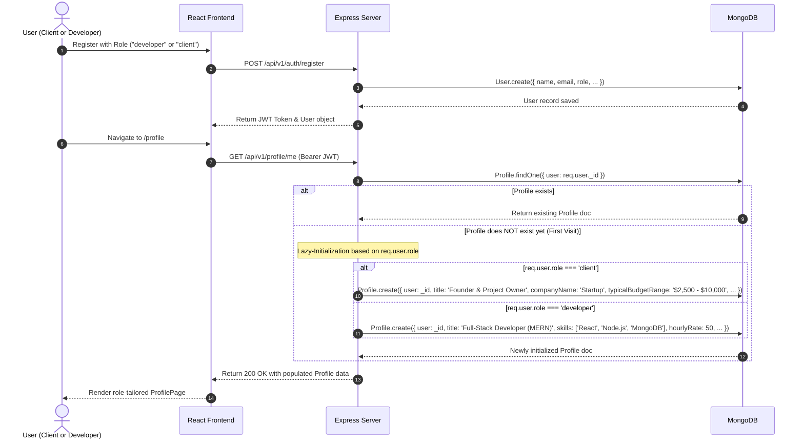
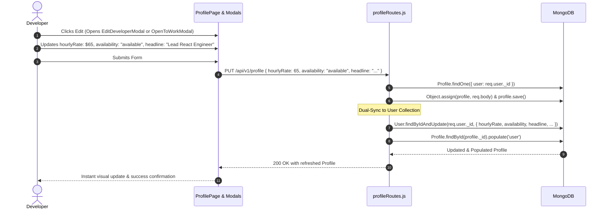
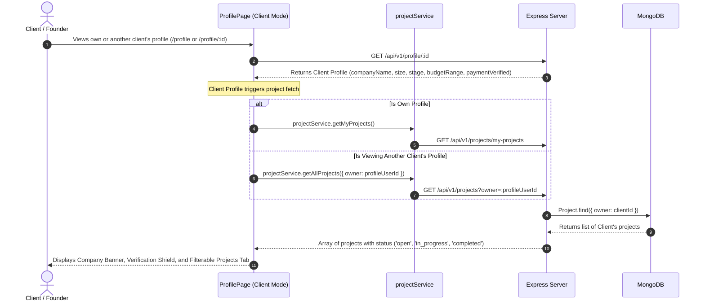
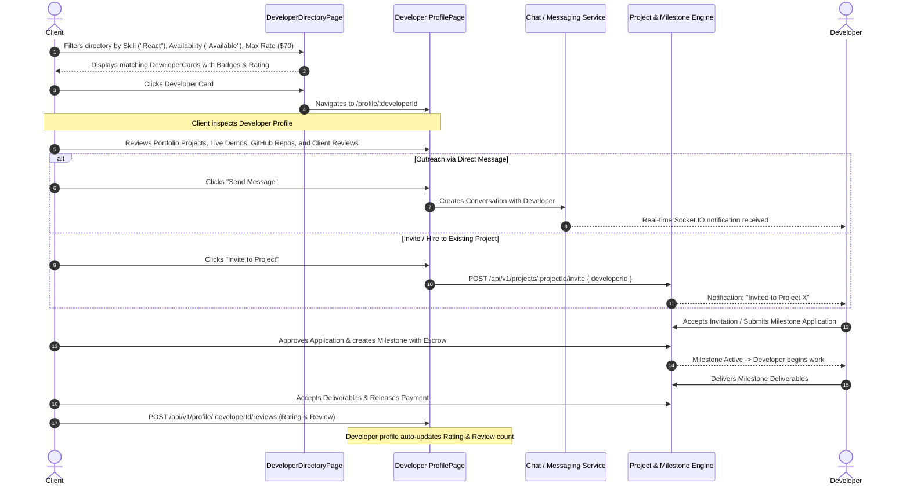
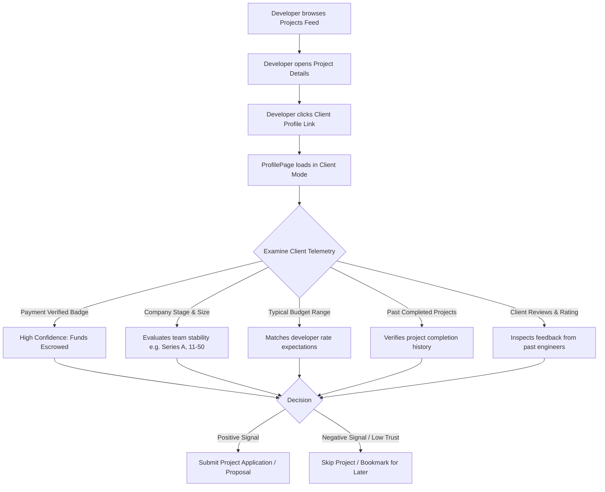

# DevConnect Profile System: Client & Developer Architecture, Schemas, and End-to-End Flows

## 1. Executive Summary

In the **DevConnect** ecosystem, the Profile system is a foundational pillar that powers identity, discovery, trust, and hiring. The platform uses a **role-adaptive dual-persona profile architecture**:

- **Developer Profile Persona**: Designed for engineers, freelancers, and students. Emphasizes technical skills, proficiency levels, verified portfolio showcases, work experience, GitHub open-source repositories, academic background, certifications, availability status, and client reviews.
- **Client (Company / Project Owner) Profile Persona**: Designed for startup founders, recruiters, and enterprise managers. Emphasizes company credibility, industry, team size, funding stage, verified payment status, hiring needs, typical project budgets, active job/project postings, and platform reputation.

Both personas share a unified **Mongoose 1:1 data model** linked to the `User` document, while the frontend dynamically shifts its layout, action buttons, modals, and tab navigation based on the profile owner's role (`developer` vs `client`).

---

## 2. High-Level System Architecture

```
+----------------------------------------------------------------------------------------------------+
|                                         CLIENT (REACT + VITE SPA)                                  |
|                                                                                                    |
|    +------------------------------------------------------------------------------------------+    |
|    |                                    ProfilePage.jsx                                       |    |
|    | - Daylight Hero Banner + Custom Avatar Upload + Shield Verification Badge                |    |
|    | - Action Bar: [Open To / Hiring] [Add Section] [Enhance Profile] [Resources]            |    |
|    +------------------------------------------------------------------------------------------+    |
|                   |                                                          |                     |
|         (role === 'developer')                                      (role === 'client')            |
|                   v                                                          v                     |
|    +---------------------------------------+          +---------------------------------------+    |
|    |       Developer Profile View          |          |         Client Profile View           |    |
|    | - Tabs: Overview, Skills, Portfolio,  |          | - Tabs: Company Overview, Posted      |    |
|    |   Experience, Education, Open Source, |          |   Projects, Hiring Needs, About,      |    |
|    |   Reviews, Activity                   |          |   Activity                            |    |
|    | - Modals: EditDeveloperModal,         |          | - Modals: EditCompanyModal,           |    |
|    |   OpenToWorkModal, AddSectionModal,   |          |   OpenToWorkModal (Hiring talent),    |    |
|    |   BannerPickerModal                   |          |   BannerPickerModal                   |    |
|    +---------------------------------------+          +---------------------------------------+    |
+----------------------------------------------------------------------------------------------------+
                                                  |
                                   REST API Calls (Bearer JWT)
                                                  v
+----------------------------------------------------------------------------------------------------+
|                                    BACKEND REST ENGINE (EXPRESS.JS)                                |
|                                                                                                    |
|  +------------------------------+  +----------------------------+  +----------------------------+  |
|  |       profileRoutes.js       |  |     discoveryRoutes.js     |  |        userRoutes.js       |  |
|  | - GET /api/profile/me        |  | - GET /api/discovery/devs |  | - GET /api/users/:id       |  |
|  | - GET /api/profile/:id       |  | - POST /bookmarks          |  | - PATCH /api/users/profile |  |
|  | - PUT /api/profile           |  | - POST /follow             |  |                            |  |
|  | - Sub-resources (CRUD)       |  | - POST /saved-searches     |  |                            |  |
|  +------------------------------+  +----------------------------+  +----------------------------+  |
|                                                  |                                                 |
|                        +-------------------------+-------------------------+                       |
|                        | Dual-Sync Layer (Syncs Profile.js <-> User.js)     |                       |
|                        +---------------------------------------------------+                       |
+----------------------------------------------------------------------------------------------------+
                                                  |
                                                  v
+----------------------------------------------------------------------------------------------------+
|                                         MONGODB DATABASE                                           |
|                                                                                                    |
|  +--------------------------------------------+    +--------------------------------------------+  |
|  |                  User.js                   |    |                 Profile.js                 |  |
|  | - _id, name, username, email, password     |1--1| - user (ref: 'User', unique, indexed)      |  |
|  | - role ('developer' | 'client' | ...)      |    | - Developer: portfolio, experience, edu,   |  |
|  | - Mirrored fields: avatar, headline, bio,  |    |   openSource, skillsWithProficiency        |  |
|  |   location, availability, skills, rate     |    | - Client: companyName, companySize, stage, |  |
|  +--------------------------------------------+    |   industry, hiringNeeds, budgetRange       |  |
|                                                    +--------------------------------------------+  |
+----------------------------------------------------------------------------------------------------+
```

---

## 3. Data Models: Developer vs Client Attributes

DevConnect uses two core Mongoose models to handle user and profile records: [User.js](file:///d:/community/server/src/models/User.js) and [Profile.js](file:///d:/community/server/src/models/Profile.js).

### 3.1 Field Comparison Matrix

| Category | Field Name | Type | Developer Usage | Client Usage |
| :--- | :--- | :--- | :--- | :--- |
| **Core Identity** | `user` | `ObjectId` | Reference to parent `User` record | Reference to parent `User` record |
| **Identity** | `name` (User) | `String` | Engineer's real name | Founder / Hiring Manager name |
| **Identity** | `title` / `headline` | `String` | e.g. "Full-Stack Developer (MERN)" | e.g. "Founder & Project Owner" |
| **Identity** | `about` / `bio` | `String` | Technical summary & background | Company vision & team mission |
| **Identity** | `avatar` / `avatarUrl` | `String` | Developer profile picture | Founder photo or company emblem |
| **Identity** | `bannerImage` | `String` | Desk / Coding workstation banner | Brand / Studio / Modern office banner |
| **Location** | `location` & `timezone`| `String` | Physical city, country & UTC offset | Company HQ city & primary timezone |
| **Status** | `availability` | `Enum` | `available`, `busy`, `open_to_offers` | `available` (Actively hiring) |
| **Preferences** | `openTo` | `[String]` | `['full_time', 'freelance', 'contract']` | Opportunity types offered |
| **Rates / Budget** | `hourlyRate` | `Number` | Developer's hourly asking rate ($/hr) | Typically 0 / Not used directly |
| **Rates / Budget** | `typicalBudgetRange` | `String` | N/A | e.g. "$2,500 – $10,000 (Medium Project)" |
| **Company Data** | `companyName` | `String` | Previous / Current employer (Ex-Vinirji) | Company or Startup name |
| **Company Data** | `companyWebsite` | `String` | Optional | Official company website URL |
| **Company Data** | `industry` | `String` | N/A | e.g. "Software & SaaS", "AI / ML" |
| **Company Data** | `companySize` | `String` | N/A | e.g. "1-10 Employees", "11-50 Employees"|
| **Company Data** | `companyStage` | `String` | N/A | "Bootstrapped", "Seed", "Series A" |
| **Hiring** | `hiringNeeds` | `[String]` | N/A | Target skillsets (e.g. `['React', 'Go']`) |
| **Verification** | `paymentVerified` | `Boolean` | Secondary verification | Shield indicating validated escrow funds|
| **Skills** | `skills` & `techStack`| `[String]` | Flat list for search & discovery | Preferred stack for company projects |
| **Skills** | `skillsWithProficiency` | `[SubDoc]` | Name, category, proficiency & years | N/A |
| **Portfolio** | `portfolio` | `[SubDoc]` | Showcase projects with live & repo URLs | N/A |
| **Work History**| `experience` | `[SubDoc]` | Roles, companies, dates & impact | N/A |
| **Education** | `education` | `[SubDoc]` | College, degree, graduation year | N/A |
| **Open Source** | `openSource` | `[SubDoc]` | Repositories, stars, forks & language | N/A |
| **Reviews** | `reviews` | `[SubDoc]` | Client reviews & 1-5 star ratings | Developer feedback on client collaboration |

---

## 4. End-to-End System Flows

### 4.1 Flow 1: Registration, Role Assignment & Profile Initialization

When a user signs up on DevConnect, their account is initialized with an explicit role (`developer`, `client`, `freelancer`, `student`). The backend implements a **Lazy Auto-Initialization pattern** on the first profile fetch.



---

### 4.2 Flow 2: Developer Profile Enrichment & Dual-Sync

When a developer modifies their headline, bio, hourly rate, or avatar, updates are submitted to `PUT /api/v1/profile`. The backend applies a **Dual-Sync** strategy so common user attributes stay identical in both `Profile` and `User` documents.



---

### 4.3 Flow 3: Client Profile & Project Integration Flow

Unlike developers whose primary assets are portfolio projects and skills, a Client's profile showcases their **Company Credentials** and their **Live Project Listings**.



---

### 4.4 Flow 4: Client Discovering, Evaluating & Hiring a Developer

The complete lifecycle connecting the Client profile and Developer profile through Discovery, Direct Outreach, and Milestone-backed Hiring:



---

### 4.5 Flow 5: Developer Evaluating Client Credibility Before Applying

A key feature of DevConnect is protecting developers from non-serious or fraudulent postings by exposing rich client profile telemetry:



---

## 5. Frontend View & Modal Specifications

The frontend profile experience is anchored in [ProfilePage.jsx](file:///d:/community/client/src/pages/ProfilePage.jsx) alongside 6 specialized modals in [client/src/components/profile/](file:///d:/community/client/src/components/profile):

### 5.1 Hero Header Section (Shared Layout with Dynamic Badges)
- **Banner Area**: Features daylight minimalist imagery, supports preset selection or custom image URL/upload via [BannerPickerModal.jsx](file:///d:/community/client/src/components/profile/BannerPickerModal.jsx).
- **Avatar & Shield**: Overlapping circular avatar with camera upload icon (for owner) and verified account shield badge.
- **Intro Row**:
  - Full Name, Gender Pronouns or Client tag.
  - Role-specific Headline (`title` / `headline`).
  - Location, Contact link, Connection count, and Hourly Rate pill (for developers).
  - Academic / Company emblem: Displays university logo (e.g., RGUKT ONGOLE) for developers, or company badge for clients.
- **Action Buttons Bar**:
  - `Open to`: Launches [OpenToWorkModal.jsx](file:///d:/community/client/src/components/profile/OpenToWorkModal.jsx). In developer mode, controls job roles and availability; in client mode, highlights active hiring campaigns.
  - `Add section`: Launches [AddSectionModal.jsx](file:///d:/community/client/src/components/profile/AddSectionModal.jsx) to add Experience, Education, Showcase Project, Open Source Repo, or Certification.
  - `Enhance profile`: Launches [EnhanceProfileModal.jsx](file:///d:/community/client/src/components/profile/EnhanceProfileModal.jsx) with AI-powered suggestions for headlines, bios, and skill tags.
  - `Resources`: Direct navigation to Activity and Platform Resources.

---

### 5.2 Client-Specific Profile Tabs

When `profileUser.role === 'client'`, the following tabs are rendered:

1. **Company Overview (`overview`)**:
   - Company Mission & About summary.
   - Company Metrics Grid:
     - **Industry** (e.g., *Software & SaaS*, *AI / ML*, *FinTech*).
     - **Company Size** (e.g., *1-10*, *11-50*, *51-200*, *500+*).
     - **Funding Stage** (e.g., *Bootstrapped*, *Seed*, *Series A*).
     - **Typical Budget** (e.g., *$2,500 – $10,000*).
     - **Payment Status** (*Verified Escrow Partner* badge).
   - Snapshot of current active projects.
2. **Posted Projects (`projects`)**:
   - Displays all projects created by this client via `projectService`.
   - Filter pill buttons: `All`, `Open`, `In Progress`, `Completed`.
   - Each project card links directly to [ProjectDetailsPage.jsx](file:///d:/community/client/src/pages/ProjectDetailsPage.jsx) or [ProjectWorkspacePage.jsx](file:///d:/community/client/src/pages/ProjectWorkspacePage.jsx).
3. **Hiring Needs & Terms (`hiring`)**:
   - Specific roles required (e.g., *Senior Backend Specialist*, *React Mobile Engineer*).
   - Preferred engagement models (*Fixed-Price Milestone*, *Hourly Retainer*).
4. **About Company (`about`)**:
   - Extended company background, executive team overview, and external links (Website, LinkedIn, Twitter/X).
5. **Activity (`activity`)**:
   - Timeline of client updates, community posts, and recent milestone approvals.

---

### 5.3 Developer-Specific Profile Tabs

When `profileUser.role === 'developer'`, the following tabs are rendered:

1. **Overview (`overview`)**:
   - Bio / Technical Summary card.
   - Core Skills Chips & Tech Stack badges.
   - Featured Projects preview.
   - Latest Experience & Education timeline card.
2. **Skills & Tools (`skills`)**:
   - Categorized skills breakdown: Frontend, Backend, Databases, Cloud & DevOps, Mobile.
   - Proficiency ratings: *Beginner*, *Intermediate*, *Advanced*, *Expert*.
   - Years of experience per skill.
   - Inline add/remove skill manager for profile owner.
3. **Portfolio (`portfolio`)**:
   - Detailed showcase projects with live demo URLs, GitHub repository links, and contribution descriptions.
   - Verified project badge (indicates projects verified through DevConnect milestones).
4. **Experience (`experience`)**:
   - Full employment history: Company, Role, Employment Type (Full-time, Contract), Period, Location, and accomplishment bullets.
5. **Education & Certifications (`education`)**:
   - University degrees, fields of study, graduation years.
   - Professional certifications with credential IDs and verification URLs.
6. **Open Source (`opensource`)**:
   - GitHub repositories with live star counts, fork metrics, primary programming language, and repository links.
7. **Reviews (`reviews`)**:
   - Client ratings (1 to 5 stars), written testimonials, reviewer avatar, and timestamp.
   - Aggregate star rating displayed in hero card.
8. **Activity (`activity`)**:
   - Developer posts, community replies, code snippets shared, and milestone completions.

---

## 6. Complete API Reference

All profile endpoints are registered under `/api/profile` (or `/api/v1/profile`) in [server/src/routes/profileRoutes.js](file:///d:/community/server/src/routes/profileRoutes.js).

### 6.1 `GET /api/profile/me`
- **Auth**: Required (`Bearer <JWT>`)
- **Description**: Returns the profile of the authenticated user. Automatically creates an initialized profile if none exists.
- **Response `200 OK`**:
```json
{
  "_id": "6710abcd1234567890ef0001",
  "user": {
    "_id": "6710abcd1234567890ef0000",
    "name": "Kethavath Kumara Swami Naik",
    "email": "developer@devconnect.dev",
    "username": "kumaraswami",
    "role": "developer",
    "avatar": "https://api.dicebear.com/7.x/avataaars/svg?seed=dev",
    "headline": "Full-Stack Developer (MERN)",
    "location": "Hyderabad, Telangana, India"
  },
  "title": "Full-Stack Developer (MERN)",
  "about": "Full-stack engineer specializing in React, Node.js, and high-performance microservices.",
  "hourlyRate": 50,
  "availability": "available",
  "skills": ["React.js", "Node.js", "MongoDB", "REST APIs", "Kotlin"],
  "techStack": ["Express.js", "Tailwind CSS", "Redux Toolkit", "Git", "Docker"],
  "experience": [
    {
      "company": "Ex-Vinirji",
      "role": "Full-Stack Engineer",
      "employmentType": "Full-Time",
      "period": "2023 – Present",
      "description": "Built production vendor portal, rider delivery backend, and core REST APIs."
    }
  ],
  "portfolio": [],
  "reviews": [],
  "rating": 5.0
}
```

---

### 6.2 `GET /api/profile/:id`
- **Auth**: Optional (`public` profiles are open; `authenticated` requires token; `private` requires ownership).
- **Parameter**: Can be a **Profile ObjectId**, a **User ObjectId**, or a **Username** string.
- **Description**: Finds and populates profile details for viewing someone else's public profile.
- **Response `200 OK`** / **`404 Not Found`**.

---

### 6.3 `PUT /api/profile`
- **Auth**: Required (`Bearer <JWT>`)
- **Description**: Updates profile fields and synchronizes duplicate user properties (name, headline, bio, avatar, skills, location, hourlyRate) to the `User` collection.
- **Request Body (Client Example)**:
```json
{
  "name": "Alex Mercer",
  "title": "Founder & Managing Director",
  "companyName": "NovaTech Ventures",
  "companyWebsite": "https://novatech.io",
  "industry": "Software & SaaS",
  "companySize": "11-50 Employees",
  "companyStage": "Series A",
  "typicalBudgetRange": "$10,000 – $30,000 (Full-Scale Build)",
  "location": "San Francisco, CA",
  "hiringNeeds": ["Senior Go Developer", "React Architect", "Cloud Security Engineer"]
}
```
- **Request Body (Developer Example)**:
```json
{
  "title": "Senior Frontend Architect",
  "about": "10+ years engineering modern reactive web systems.",
  "hourlyRate": 75,
  "availability": "open_to_offers",
  "openTo": ["freelance", "contract"],
  "preferredRoles": ["Frontend Lead", "React Consultant"],
  "skills": ["React", "TypeScript", "Next.js", "GraphQL", "TailwindCSS"]
}
```
- **Response `200 OK`**: Returns updated, populated profile.

---

### 6.4 Sub-Resource Endpoints

| Method | Endpoint | Description | Payloads |
| :--- | :--- | :--- | :--- |
| `POST` | `/api/profile/experience` | Append work experience item | `{ company, role, employmentType, period, location, description }` |
| `DELETE` | `/api/profile/experience/:id` | Remove work experience item | None (URL parameter `:id`) |
| `POST` | `/api/profile/education` | Append education credential | `{ institution, degree, fieldOfStudy, year, description }` |
| `DELETE` | `/api/profile/education/:id` | Remove education item | None (URL parameter `:id`) |
| `POST` | `/api/profile/portfolio` | Add portfolio showcase project | `{ title, description, category, skills, liveUrl, repoUrl, role }` |
| `DELETE` | `/api/profile/portfolio/:id` | Remove showcase project | None (URL parameter `:id`) |
| `POST` | `/api/profile/opensource` | Add open source repository | `{ repoName, description, url, stars, forks, language }` |
| `DELETE` | `/api/profile/opensource/:id` | Remove open source repo | None (URL parameter `:id`) |
| `POST` | `/api/profile/certifications` | Add professional certificate | `{ name, issuer, credentialUrl, credentialId, issueDate }` |
| `DELETE` | `/api/profile/certifications/:id` | Delete certificate | None (URL parameter `:id`) |
| `POST` | `/api/profile/:id/reviews` | Post client review / rating | `{ rating: 5, comment: "Exceptional code quality and timely delivery." }` |

---

### 6.5 Discovery & Search Endpoints ([discoveryRoutes.js](file:///d:/community/server/src/routes/discoveryRoutes.js))

- `GET /api/discovery/developers`
  - **Query Parameters**: `q`, `skill`, `skills`, `category`, `experienceLevel`, `availability`, `openTo`, `role`, `location`, `minRating`, `sort`, `page`, `limit`.
  - **Privacy Enforcement**: Filters out `visibility: 'private'` profiles. If unauthenticated, only `visibility: 'public'` profiles are matched.
  - **Response**: Array of developer summary cards with pagination metadata (`total`, `totalPages`, `page`).
- `POST /api/discovery/bookmarks/:developerId`: Toggle bookmarking a developer.
- `POST /api/discovery/follow/:userId`: Follow a developer or client.
- `POST /api/discovery/saved-searches`: Save search filter criteria for notification alerts.

---

## 7. Security, Privacy & Data Integrity

1. **Authorization & Ownership Gates**:
   - Only the profile owner authenticated with a valid JWT token can access `PUT /api/profile` or sub-resource `POST`/`DELETE` routes.
   - Public view routes enforce visibility checks (`public` vs `authenticated` vs `private`).
2. **Dual-Sync Consistency**:
   - To prevent stale user data when queries hit `/api/users` versus `/api/profile`, any update to `profileRouter.put('/')` automatically triggers a synced update to `User.findByIdAndUpdate`.
3. **Escrow & Review Authenticity**:
   - Review routes recalculate the aggregate profile `rating` (`(sum / count).toFixed(1)`) atomically on review creation.
   - `paymentVerified` is linked to verified payment credentials in Stripe / Payment gateways to prevent client impersonation.

---

## 8. Summary Table: Client Profile vs Developer Profile

| Feature Dimension | Client Profile (`role === 'client'`) | Developer Profile (`role === 'developer'`) |
| :--- | :--- | :--- |
| **Primary Goal** | Attract top engineering talent & prove credibility | Showcase technical expertise & win contracts/jobs |
| **Hero Status Box** | "Hiring talent · Active open projects" | "Open to work · Recruiters only" |
| **Edit Modal** | `EditCompanyModal.jsx` | `EditDeveloperModal.jsx` |
| **Key Metrics** | Funding stage, company size, payment verification, budget range | Hourly rate, rating, experience level, total connections |
| **Core Tab 1** | Company Overview & Metrics | Overview & Technical Bio |
| **Core Tab 2** | Posted Projects (Filtered by Open/Active/Closed) | Skills & Categorized Proficiency Chips |
| **Core Tab 3** | Hiring Needs & Terms | Portfolio Showcase with Live & Code Links |
| **Core Tab 4** | About Company & Leadership | Work History / Employment Experience |
| **Core Tab 5** | Activity Feed | Education, Certifications & Open Source Repos |
| **Discovery Route** | Found via Project Feed & Marketplace Posts | Found via Developer Directory & Skill Search |
