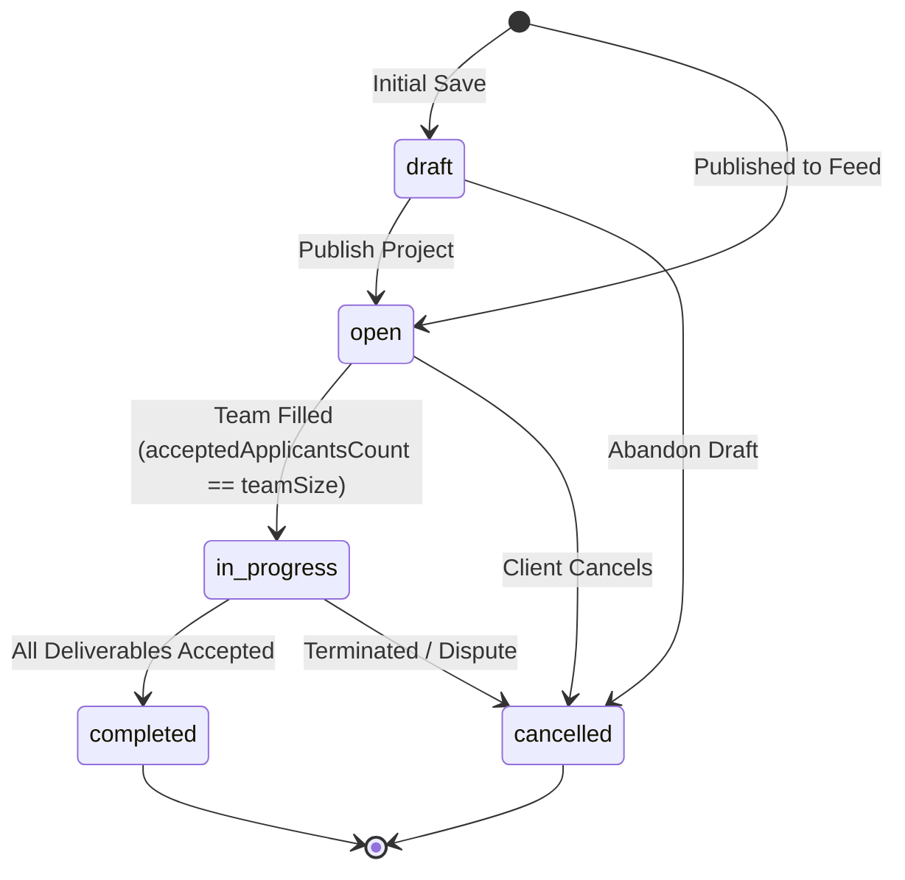
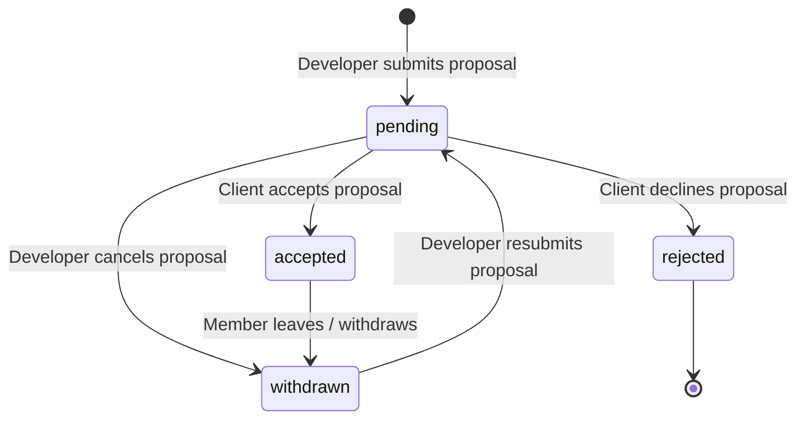

# DevConnect Project Feed & Marketplace: Architecture, Schemas, Discovery Engines, and End-to-End Flows

## 1. Executive Summary

In the **DevConnect** ecosystem, the **Project Feed** (also referred to as the **Project Marketplace** and **Project Discovery**) serves as the core economic exchange connecting project visionaries (clients, founders, tech leads) with engineering talent (developers, architects, designers).

The Project Feed system is engineered around several core functional objectives:
1. **Multi-Faceted Project Publication & Lifecycle**: Clients can define and post real software requirements, structured budgets (min/max ranges), required tech stacks, team size caps, and delivery timelines.
2. **Intelligent Discovery & Full-Text Search**: Developers can explore live listings using high-performance compound MongoDB indexes, category pills, dynamic regex searches, and budget thresholds.
3. **Personalized Skill-Match Recommendation Engine**: Matches the active developer's authenticated profile skills against project requirements, generating algorithmic match percentages and curated recommendation carousels.
4. **Frictionless Proposal & Application Pipeline**: Developers can review project scopes and submit proposals (cover letter, proposed compensation) either directly via the interactive Quick Apply modal or on the project detail view.
5. **Team Onboarding & Status Progression**: Automatic state transitions enforce that once an applicant is accepted, they are added to the project's member roster; once all seats are filled, the project transitions seamlessly from `open` to `in_progress`.

---

## 2. High-Level System Architecture

```
+----------------------------------------------------------------------------------------------------+
|                                    CLIENT (REACT + VITE SPA)                                       |
|                                                                                                    |
|    +--------------------------------+   +--------------------------------+   +----------------+    |
|    |      ProjectsFeedPage.jsx      |   |    ProjectDiscoveryPage.jsx    |   | ProjectCard.jsx|    |
|    | - Live MongoDB Atlas Indicator |   | - Multi-attribute Filter Panel |   | - Quick Apply  |    |
|    | - Recommended Projects Strip   |   | - Advanced Budget Min/Max      |   |   Modal        |    |
|    | - Category Filter Pills        |   | - Skills Search & Pagination   |   | - Bookmark     |    |
|    | - Search & Sort Controls       |   |                                |   | - Match Pill   |    |
|    +--------------------------------+   +--------------------------------+   +----------------+    |
|                   |                                     |                             |            |
|                   +------------------+------------------+-----------------------------+            |
|                                      v                                                             |
|         +-----------------------------------------------------------------------+                  |
|         |                     Frontend Services & Zustand Store                 |                  |
|         | - [projectService.js](file:///d:/community/client/src/services/projectService.js)                     |                  |
|         | - [discoveryService.js](file:///d:/community/client/src/services/discoveryService.js)                 |                  |
|         | - [useProjectStore.js](file:///d:/community/client/src/store/useProjectStore.js)                       |                  |
|         | - [apiClient.js](file:///d:/community/client/src/services/apiClient.js)                               |                  |
|         +-----------------------------------------------------------------------+                  |
+----------------------------------------------------------------------------------------------------+
                                                   |
                                     REST API Calls (Bearer JWT)
                                                   v
+----------------------------------------------------------------------------------------------------+
|                                  BACKEND REST ENGINE (EXPRESS.JS)                                  |
|                                                                                                    |
|  +------------------------------+  +----------------------------+  +----------------------------+  |
|  |       projectRoutes.js       |  |     discoveryRoutes.js     |  |    applicationRoutes.js    |  |
|  | - GET /api/projects          |  | - GET /discovery/projects  |  | - GET /my-applications     |  |
|  | - POST /api/projects         |  | - GET /recommendations/    |  | - GET /project/:id         |  |
|  | - GET /api/projects/:id      |  |   projects                 |  | - PATCH /:id/status        |  |
|  | - POST /:id/applications     |  | - Text Search & Budget Min |  |   (Accept / Reject)        |  |
|  | - GET /my-projects           |  | - Pagination Meta          |  |                            |  |
|  +------------------------------+  +----------------------------+  +----------------------------+  |
|                 |                                |                                |                |
|                 +--------------------------------+--------------------------------+                |
|                                                  |                                                 |
|                 +----------------------------------------------------------------+                 |
|                 | Middlewares: protect (Auth), sanitizeQuery, workspaceAccess    |                 |
|                 | Helpers: notifications.js, ProjectActivity audit logging       |                 |
|                 +----------------------------------------------------------------+                 |
+----------------------------------------------------------------------------------------------------+
                                                   |
                                                   v
+----------------------------------------------------------------------------------------------------+
|                                        MONGODB ATLAS DATABASE                                      |
|                                                                                                    |
|  +-------------------------------+   +-------------------------------+   +----------------------+  |
|  |          Project.js           |   |        Application.js         |   |    ProjectMember.js  |  |
|  | - title, description, owner   |1-N| - project (ref: 'Project')    |   | - project (ref)      |  |
|  | - category, projectType       |   | - applicant (ref: 'User')     |   | - user (ref)         |  |
|  | - budgetMin, budgetMax        |   | - status (pending/accepted)   |   | - role (owner/member)|  |
|  | - requiredSkills, status      |   | - proposedRate, coverLetter   |   | - status (active)    |  |
|  | - compound & text indexes     |   | - compound unique index       |   |                      |  |
|  +-------------------------------+   +-------------------------------+   +----------------------+  |
|                 |                                                                                  |
|                 +----------------------------------------------------------------------------------+
+----------------------------------------------------------------------------------------------------+
```

---

## 3. Data Models, Schemas & Constraints

The project feed rests on two primary database schemas: [Project.js](file:///d:/community/server/src/models/Project.js) and [Application.js](file:///d:/community/server/src/models/Application.js), linked with [User.js](file:///d:/community/server/src/models/User.js) and [ProjectMember.js](file:///d:/community/server/src/models/ProjectMember.js).

### 3.1 Project Schema Definition ([Project.js](file:///d:/community/server/src/models/Project.js))

| Field Name | Type | Constraints & Defaults | Description |
| :--- | :--- | :--- | :--- |
| `title` | `String` | `required: true`, min: 3, max: 120, `trim: true` | Display headline for the project posting |
| `description` | `String` | `required: true`, min: 10, max: 5000, `trim: true` | Detailed specifications, requirements, and deliverables |
| `owner` | `ObjectId` | `required: true`, `ref: 'User'`, `index: true` | Reference to project creator (client/founder) |
| `category` | `String` | Default: `'Web Development'`, `trim: true` | Domain category (e.g., `'Web Development'`, `'AI & ML'`, `'FinTech'`, `'Cloud & DevOps'`) |
| `projectType` | `String` | `enum: ['collaboration', 'freelance', 'academic', 'open_source']`, default: `'collaboration'` | Nature of the project engagement |
| `experienceLevel`| `String` | `enum: ['beginner', 'intermediate', 'expert', 'all']`, default: `'intermediate'` | Expected developer proficiency tier |
| `teamSize` | `Number` | Default: 1, min: 1, max: 100 | Maximum capacity of accepted developer positions |
| `acceptedApplicantsCount` | `Number` | Default: 0, min: 0 | Number of developers currently accepted onto the team |
| `budget` | `String` | Default: `'$1,000 - $3,000'` | User-facing display budget string |
| `budgetMin` | `Number` | Default: 0, min: 0 | Lower numeric bound for queries and filtering |
| `budgetMax` | `Number` | Default: 0, min: 0 | Upper numeric bound for queries and filtering |
| `currency` | `String` | Default: `'USD'`, uppercase | Currency code (e.g. USD, EUR) |
| `duration` | `String` | Default: `'1 - 2 Months'` | Estimated engagement duration (e.g. `'1 Month'`, `'3 Months'`) |
| `commitment` | `String` | `enum: ['full_time', 'part_time', 'flexible']`, default: `'flexible'` | Expected time availability commitment |
| `visibility` | `String` | `enum: ['public', 'private']`, default: `'public'`, `index: true` | Feed discovery visibility |
| `status` | `String` | `enum: ['draft', 'open', 'in_progress', 'completed', 'cancelled']`, default: `'open'`, `index: true` | Current project lifecycle state |
| `requiredSkills`| `[String]` | Array of strings (max: 25) | Required technical stack tags (e.g. `['React', 'Node.js', 'MongoDB']`) |
| `deadline` | `Date` | Optional | Milestone or project completion deadline |
| `applicationDeadline`| `Date` | Optional | Cutoff date for receiving developer proposals |
| `members` | `[Object]` | Embedded: `{ user: ObjectId, role: String, joinedAt: Date }` | Embedded project roster snapshot |
| `applicationsCount` | `Number`| Default: 0, min: 0 | Counter for total submitted proposals |
| `githubRepoUrl` | `String` | Default: `''` | Optional linked GitHub repository |
| `liveDemoUrl` | `String` | Default: `''` | Optional production URL preview |

#### Compound & Text Indexes on Project
```javascript
// Compound indexes for high-throughput feed filtering:
projectSchema.index({ status: 1, visibility: 1, createdAt: -1 });
projectSchema.index({ owner: 1, createdAt: -1 });
projectSchema.index({ category: 1, status: 1 });
projectSchema.index({ requiredSkills: 1, status: 1 });

// Full-text search index weighted for relevance:
projectSchema.index(
  { title: 'text', description: 'text', requiredSkills: 'text' },
  { weights: { title: 10, requiredSkills: 5, description: 1 } }
);
```

### 3.2 Application Schema Definition ([Application.js](file:///d:/community/server/src/models/Application.js))

| Field Name | Type | Constraints & Defaults | Description |
| :--- | :--- | :--- | :--- |
| `project` | `ObjectId` | `required: true`, `ref: 'Project'`, `index: true` | The target project being applied for |
| `applicant` | `ObjectId` | `required: true`, `ref: 'User'`, `index: true` | The developer submitting the application |
| `coverLetter` | `String` | max: 3000 chars, `trim: true`, default: `''` | Pitch, relevant experience, and architectural proposal |
| `proposedRate` | `String` | max: 100 chars, `trim: true`, default: `''` | Developer's proposed fee (e.g. `'$4,500 Fixed'` or `'$60/hr'`) |
| `status` | `String` | `enum: ['pending', 'accepted', 'rejected', 'withdrawn']`, default: `'pending'` | Current status of the proposal |
| `decisionReason`| `String` | max: 1000 chars, default: `''` | Client explanation or feedback upon decision |
| `reviewedAt` | `Date` | Optional | Timestamp when owner reviewed the application |
| `reviewedBy` | `ObjectId` | `ref: 'User'` | Owner/admin who evaluated the proposal |
| `applicantSnapshot`| `Object` | `{ name, username, headline, avatar, skills }` | Point-in-time snapshot of applicant identity |
| `resumeUrl` | `String` | Default: `''` | Optional external portfolio / PDF link |

#### Invariant: One Application per User per Project
```javascript
// Compound unique index ensuring developers cannot submit duplicate proposals:
applicationSchema.index({ project: 1, applicant: 1 }, { unique: true });
applicationSchema.index({ applicant: 1, createdAt: -1 });
applicationSchema.index({ project: 1, status: 1 });
```

---

## 4. State Machines & Status Transitions

### 4.1 Project State Machine



- **`draft`**: Visible only to the owner; not indexed in the public feed.
- **`open`**: Fully discoverable in [ProjectsFeedPage.jsx](file:///d:/community/client/src/pages/ProjectsFeedPage.jsx) and [ProjectDiscoveryPage.jsx](file:///d:/community/client/src/pages/ProjectDiscoveryPage.jsx). Developers can submit proposals.
- **`in_progress`**: Team capacity has been reached or development has commenced. Still discoverable for audit/viewing, but new applications are restricted.
- **`completed`**: Project concluded; deliverables verified.
- **`cancelled`**: Terminated before completion.

### 4.2 Application State Machine



- **`pending`**: Active proposal under review by client.
- **`accepted`**: Triggers immediate creation of `ProjectMember` record, increments `acceptedApplicantsCount`, and may advance project status to `in_progress`.
- **`rejected`**: Proposal declined; cannot be modified by client afterwards.
- **`withdrawn`**: Developer voluntarily removes application before review or after acceptance.

---

## 5. Discovery, Filtering & Matching Architecture

### 5.1 Query Resolution Pipeline

When a developer navigates to the Project Feed, two primary backend endpoints are queried:
1. `GET /api/projects` in [projectRoutes.js](file:///d:/community/server/src/routes/projectRoutes.js#L51-L162)
2. `GET /api/discovery/projects` in [discoveryRoutes.js](file:///d:/community/server/src/routes/discoveryRoutes.js#L185-L256)

#### Query Pipeline Flow:
```
Incoming Request -> Sanitize Params -> Build Match Filter -> Execute Count & Find -> Populate Owner -> Return Paginated Payload
```

1. **Visibility & Status Guard**:
   ```javascript
   filter.status = status ? status.toLowerCase() : { $in: ['open', 'in_progress'] };
   filter.visibility = { $in: ['public', null, undefined] };
   ```
2. **Regex Query Normalization**:
   User search inputs (`q`) are sanitized to escape special regex characters (`.*+?^${}()|[]\`) and applied across three key fields with case-insensitivity:
   ```javascript
   filter.$or = [
     { title: { $regex: sanitizedQ, $options: 'i' } },
     { description: { $regex: sanitizedQ, $options: 'i' } },
     { requiredSkills: { $regex: sanitizedQ, $options: 'i' } },
   ];
   ```
3. **Category Special-Case Handlers**:
   - `'All Projects'` / `'All Categories'` is omitted from filter.
   - `'AI & ML'` dynamically maps to `/ai/i`.
   - `'Cloud & DevOps'` dynamically maps to `/cloud|devops/i`.
4. **Numeric Range Budget Filters**:
   Projects have both `budgetMin` and `budgetMax` numeric properties:
   - Request `minBudget: 2000` evaluates against `{ budgetMax: { $gte: 2000 } }`.
   - Request `maxBudget: 8000` evaluates against `{ budgetMin: { $lte: 8000 } }`.
5. **Populated Projections**:
   To minimize payload weight while retaining essential UI data, the `owner` object is projected with:
   `name`, `username`, `email`, `avatar`, `avatarUrl`, `role`, `headline`.

### 5.2 Skill Matching & Recommendation Calculation

In [ProjectsFeedPage.jsx](file:///d:/community/client/src/pages/ProjectsFeedPage.jsx) and [discoveryRoutes.js](file:///d:/community/server/src/routes/discoveryRoutes.js), authenticated developers receive a tailored feed experience:

$$\text{Match Percentage} = \min\left(100, \left\lfloor \frac{|\text{Developer Skills} \cap \text{Project Required Skills}|}{|\text{Project Required Skills}|} \times 100 \right\rfloor\right)$$

- When `isAuthenticated` is true, the default sort order initializes to `"match"` (Skill Match Relevance).
- A specialized top-level carousel (`Recommended Projects for Your Tech Stack`) queries `discoveryService.getProjectRecommendations()`, highlighting projects with:
  - Match pill badge: e.g. `92% Match`
  - Overlapping skills tags: e.g. `(React, Node.js, MongoDB)`
  - Algorithmic justification tag: e.g. `"Matches 3 of your core verified profile skills"`

---

## 6. End-to-End System Flows

### 6.1 Flow 1: Client Posts a Project Idea

```
   Client User                     CreateProjectPage.jsx               projectRoutes.js                MongoDB
        |                                    |                                 |                          |
        |--- 1. Enters title, description -->|                                 |                          |
        |    budget min/max, duration,       |                                 |                          |
        |    tech stack pills & exp level    |                                 |                          |
        |                                    |                                 |                          |
        |--- 2. Clicks "Post Project" ------>|                                 |                          |
        |                                    |--- 3. POST /api/projects ------>|                          |
        |                                    |    (Bearer JWT + payload)       |                          |
        |                                    |                                 |--- 4. Verify user & ---->|
        |                                    |                                 |    create Project doc    |
        |                                    |                                 |<-- 5. Saved successfully-|
        |                                    |<-- 6. Returns 201 Created ------|                          |
        |<-- 7. Redirect to /projects -------|
```

1. **Authoring**: The client navigates to `/projects/create` ([CreateProjectPage.jsx](file:///d:/community/client/src/pages/CreateProjectPage.jsx)).
2. **Skills Tagging**: Skills are added interactively with tag pills (e.g. `React`, `Node.js`, `MongoDB`, `TailwindCSS`).
3. **Payload Construction**:
   ```javascript
   const payload = {
     title: data.title,
     description: data.description,
     budget: `$${data.budgetMin} - $${data.budgetMax}`,
     budgetMin: Number(data.budgetMin),
     budgetMax: Number(data.budgetMax),
     duration: data.duration,
     experienceLevel: data.experienceLevel.toLowerCase(),
     requiredSkills: skills,
     status: 'open',
     visibility: 'public'
   };
   ```
4. **Server Ingestion**: [projectRoutes.js](file:///d:/community/server/src/routes/projectRoutes.js#L211) validates that `title` and `description` meet length constraints, sets `owner = req.user._id`, saves the document, and returns HTTP 201.
5. **Feed Invalidation**: The client is navigated to `/projects`, where the new project immediately displays with the `"Hiring"` pulse status badge.

---

### 6.2 Flow 2: Developer Browsing, Filtering & Searching the Feed

```
  Developer User                    ProjectsFeedPage.jsx              discoveryRoutes.js              MongoDB
        |                                    |                                 |                          |
        |--- 1. Loads /projects ------------>|                                 |                          |
        |                                    |--- 2. GET /discovery/projects ->|                          |
        |                                    |    category="All Projects",     |--- 3. Indexed query ---->|
        |                                    |    sort="match", limit=20       |<-- 4. Projects array ----|
        |                                    |<-- 5. 200 OK + payload ---------|                          |
        |<-- 6. Renders Project Cards -------|                                 |                          |
        |                                    |                                 |                          |
        |--- 7. Clicks "FinTech" pill ------>|                                 |                          |
        |    & types "Stripe" in search      |--- 8. GET /discovery/projects ->|                          |
        |                                    |    category="FinTech", q="Stripe"                          |
        |                                    |<-- 9. Filtered Results ---------|                          |
        |<-- 10. Instant Grid Refresh -------|                                 |                          |
```

1. **Initial Mount**: [ProjectsFeedPage.jsx](file:///d:/community/client/src/pages/ProjectsFeedPage.jsx) triggers `fetchProjects()`.
2. **Category Bar**: Clicking any category pill (`Web Development`, `AI & ML`, `FinTech`, `Mobile Development`, `Cloud & DevOps`) updates state and triggers a re-fetch.
3. **Search Bar**: Debounced input filters across title, description, and required skills simultaneously.
4. **Sort Dropdown**: Allows toggling between:
   - `Sort: Skill Match Relevance` (`sort=match`)
   - `Sort: Recently Posted` (`sort=latest`)
   - `Sort: Highest Budget` (`sort=budget`)
5. **Live Atlas Controls**:
   - **Sync Atlas**: Manually invalidates and re-syncs state from the database.
   - **Seed Real Data**: Triggers test data population if the local environment requires realistic benchmark data.

---

### 6.3 Flow 3: Quick Apply Modal Proposal Flow

```
  Developer User                       ProjectCard.jsx                 projectRoutes.js                MongoDB
        |                                    |                                 |                          |
        |--- 1. Clicks "Apply" on Card ----->|                                 |                          |
        |<-- 2. Opens Quick Apply Modal -----|                                 |                          |
        |                                    |                                 |                          |
        |--- 3. Inputs proposedRate ($4.5k) -|                                 |                          |
        |    & coverLetter pitch             |                                 |                          |
        |                                    |                                 |                          |
        |--- 4. Submits form --------------->|                                 |                          |
        |                                    |--- 5. POST /projects/:id/apps ->|                          |
        |                                    |                                 |--- 6. Check duplicates ->|
        |                                    |                                 |--- 7. Create Application |
        |                                    |                                 |--- 8. Send notification -|
        |                                    |<-- 9. 201 Created --------------|                          |
        |<-- 10. Shows "Application Sent!" --|                                 |                          |
        |    & toggles button to "✓ Applied" |                                 |                          |
```

1. **Modal Trigger**: Clicking "Apply" on [ProjectCard.jsx](file:///d:/community/client/src/components/cards/ProjectCard.jsx) opens a glassmorphism modal overlay.
   - Note: If the authenticated user is a client (`role === 'client'`), the Apply button is hidden.
2. **Input Validation**: The developer enters their compensation rate (e.g. `"$4,500 Fixed"`) and pitch summary.
3. **Submission**: Dispatches `projectService.applyToProject(projectId, payload)`.
4. **Backend Ingestion**:
   - Verifies developer has not already applied (`Application.findOne({ project, applicant })`).
   - Populates `applicantSnapshot` with real-time profile data.
   - Increments `project.applicationsCount`.
   - Sends notification to the project owner via [notifications.js](file:///d:/community/server/src/utils/notifications.js).
5. **Feedback**: The modal displays a green checkmark animation (`"Application Sent!"`), closes automatically after 1200ms, and changes the card button to disabled `"\u2713 Applied"`.

---

### 6.4 Flow 4: Client Evaluating Applicants & Team Formation

```
   Project Owner                    ProjectDetailsPage.jsx          applicationRoutes.js               MongoDB
        |                                    |                                 |                          |
        |--- 1. Opens /projects/:id -------->|                                 |                          |
        |                                    |--- 2. GET /projects/:id ------->|                          |
        |                                    |    GET /applications -----------|                          |
        |                                    |<-- 3. Returns Project + Apps ---|                          |
        |<-- 4. Renders Applicant Cards -----|                                 |                          |
        |                                    |                                 |                          |
        |--- 5. Clicks "Accept Developer" -->|                                 |                          |
        |                                    |--- 6. PATCH /apps/:id/status -->|                          |
        |                                    |    { status: 'accepted' }       |                          |
        |                                    |                                 |--- 7. Set status=accepted|
        |                                    |                                 |--- 8. Create ProjectMember
        |                                    |                                 |--- 9. Increment accepted |
        |                                    |                                 |       ApplicantsCount    |
        |                                    |                                 |--- 10. If capacity full, |
        |                                    |                                 |    status='in_progress'  |
        |                                    |<-- 11. 200 OK + updated models -|                          |
        |<-- 12. Workspace Access Enabled ---|                                 |                          |
```

1. **Review**: The project owner visits [ProjectDetailsPage.jsx](file:///d:/community/client/src/pages/ProjectDetailsPage.jsx). Because `currentUserId === project.owner._id`, the incoming applicants list is displayed.
2. **Evaluation**: Owner reviews developer profile badges, headline, verified skills, and proposed rate.
3. **Acceptance**: Clicking "Accept" calls `PATCH /api/applications/:id/status` with `{ status: 'accepted' }`.
4. **Atomic Team Roster Update**:
   - `Application.status` becomes `'accepted'`.
   - A `ProjectMember` document is inserted or activated with `role: 'member'` and `status: 'active'`.
   - `project.acceptedApplicantsCount` increments by 1.
   - If `project.acceptedApplicantsCount >= project.teamSize`, the backend automatically transitions `project.status = 'in_progress'`.
5. **Activity Log & Notification**: `ProjectActivity` records an `'application_accepted'` event, and a notification alerts the developer that they have joined the project workspace.

---

## 7. Frontend View & Component Specifications

### 7.1 Page Catalog

| Page Component | Route Path | Purpose | Key Sub-components |
| :--- | :--- | :--- | :--- |
| [ProjectsFeedPage.jsx](file:///d:/community/client/src/pages/ProjectsFeedPage.jsx) | `/projects` | Primary marketplace feed displaying live projects with skill matching | `ProjectCard`, Recommended Strip, Category Bar, Search Toolbar |
| [ProjectDiscoveryPage.jsx](file:///d:/community/client/src/pages/ProjectDiscoveryPage.jsx) | `/discover-projects`<br>`/discovery/projects` | Advanced exploration directory with multi-facet filters & budget ranges | `DeveloperFilterPanel`, Budget inputs, Pagination controls |
| [ProjectDetailsPage.jsx](file:///d:/community/client/src/pages/ProjectDetailsPage.jsx) | `/projects/:id` | Full specification view, applicant list (owner), or proposal status (dev) | Milestone breakdown, Team roster, Quick Apply, Chat trigger |
| [CreateProjectPage.jsx](file:///d:/community/client/src/pages/CreateProjectPage.jsx) | `/projects/create` | Project creation wizard for founders and clients | Tag input, Experience picker, Budget sliders, Timeline select |
| [MyProjectsPage.jsx](file:///d:/community/client/src/pages/MyProjectsPage.jsx) | `/my-projects` | Project owner dashboard tracking all published postings | Metric cards (Total, Open, In Progress, Completed), Filter tabs |
| [MyApplicationsPage.jsx](file:///d:/community/client/src/pages/MyApplicationsPage.jsx) | `/applications` | Developer proposal tracker showing live review statuses | Status badges, Proposal cards, Withdraw button, Open Chat button |

### 7.2 ProjectCard Anatomy ([ProjectCard.jsx](file:///d:/community/client/src/components/cards/ProjectCard.jsx))

```
+---------------------------------------------------------------------------------+
| [🟢 Hiring]  Recent                                              [🔖 Bookmark] |
|                                                                                 |
| Enterprise AI-Powered Analytics Dashboard                          [↗ Details]  |
| Building an enterprise-grade analytics dashboard with interactive visualization |
|                                                                                 |
| ✨ 92% Skill Match (React, Node.js, MongoDB)                                    |
| [React]  [Node.js]  [MongoDB]  [TailwindCSS]  +2 more                           |
|                                                                                 |
| +-----------------------------------------------------------------------------+ |
| | 💲 $6,000 - $12,000  | 🕒 1 - 2 Months | 🏆 Expert | 👥 4 applied         | |
| +-----------------------------------------------------------------------------+ |
|                                                                                 |
| (Avatar) Vikram Founder                    [ Details ]  [ Apply / ✓ Applied ]   |
|          Verified Client                                                        |
+---------------------------------------------------------------------------------+
```

#### Visual Elements & Interactive States
- **Top Bar**: Status indicator (`Hiring` / `In Progress` / `Completed`) with a live pulsing emerald dot, creation date, and interactive bookmark button.
- **Card Glow**: Subtle `primary-500/5` gradient blur that increases opacity on hover (`hover:shadow-glow-subtle`).
- **Skill Match Pill**: Renders only when `matchingScore` is present, displaying the percentage and top 3 matched skills.
- **Metadata Quad-Grid**: 4-column structured display with icons for Budget (`DollarSign`), Timeline (`Clock`), Seniority Level (`Award`), and Applicant Count (`Users`).
- **Footer**: Verified Client avatar and identity with dual action buttons: `Details` (navigation) and `Apply` (launches Quick Apply modal).

---

## 8. Complete API Reference

### 8.1 Feed & Discovery Endpoints

#### `GET /api/projects`
Retrieves paginated projects matching specified filter criteria.

- **Access**: Public / Optional Auth
- **Query Parameters**:
  - `q` (string): Text query to search in title, description, and skills.
  - `category` (string): e.g. `'Web Development'`, `'AI & ML'`.
  - `projectType` (string): `'collaboration'`, `'freelance'`, `'academic'`, `'open_source'`.
  - `experienceLevel` (string): `'beginner'`, `'intermediate'`, `'expert'`.
  - `skills` (string): Comma-separated list (e.g. `'React,TypeScript'`).
  - `status` (string): `'open'`, `'in_progress'`, `'completed'`.
  - `minBudget` (number): Minimum max budget.
  - `maxBudget` (number): Maximum min budget.
  - `sort` (string): `'newest'`, `'oldest'`, `'budget_asc'`, `'budget_desc'`, `'deadline'`.
  - `page` (number): Page number (default: 1).
  - `limit` (number): Items per page (default: 10, max: 50).

**Sample Response (HTTP 200)**:
```json
{
  "success": true,
  "count": 10,
  "total": 38,
  "page": 1,
  "totalPages": 4,
  "projects": [
    {
      "_id": "6724a1801234567890abcdef",
      "title": "Enterprise AI-Powered Analytics Dashboard",
      "description": "Building an enterprise-grade analytics dashboard with interactive visualization...",
      "owner": {
        "_id": "6724a1001234567890abcdef",
        "name": "Vikram Founder",
        "username": "vikram",
        "avatar": "/uploads/avatars/vikram.png",
        "role": "client"
      },
      "category": "Web Development",
      "projectType": "freelance",
      "experienceLevel": "expert",
      "budget": "$6,000 - $12,000",
      "budgetMin": 6000,
      "budgetMax": 12000,
      "duration": "1 - 2 Months",
      "status": "open",
      "requiredSkills": ["React", "Node.js", "MongoDB", "TailwindCSS"],
      "teamSize": 3,
      "acceptedApplicantsCount": 1,
      "applicationsCount": 4,
      "createdAt": "2026-10-28T14:30:00.000Z"
    }
  ]
}
```

---

#### `GET /api/discovery/recommendations/projects`
Fetches top recommended projects for authenticated developers based on skill relevance and recruitment status.

- **Access**: Public / Protected (adapts to current user skills)
- **Response**: Array of `{ item: Project, score: Number, reason: String }`

---

#### `POST /api/projects`
Creates and publishes a new project listing to the feed.

- **Access**: Protected (Bearer JWT required)
- **Request Body**:
  ```json
  {
    "title": "AI Autonomous Customer Support Agent",
    "description": "Autonomous customer support agent leveraging LangChain RAG pipelines, FastAPI microservices, and live WebSocket streaming chat.",
    "category": "AI & ML",
    "projectType": "collaboration",
    "experienceLevel": "expert",
    "teamSize": 3,
    "budget": "$10,000 - $18,000",
    "budgetMin": 10000,
    "budgetMax": 18000,
    "duration": "2 - 3 Months",
    "requiredSkills": ["Python", "FastAPI", "LangChain", "VectorDB"]
  }
  ```
- **Response (HTTP 201 Created)**: Returns `{ success: true, project: { ... } }`.

---

### 8.2 Application & Proposal Endpoints

#### `POST /api/projects/:id/applications`
Submits a developer proposal to join the project team.

- **Access**: Protected (Bearer JWT required)
- **Parameters**: `id` - Project ObjectId
- **Request Body**:
  ```json
  {
    "proposedRate": "$85/hr",
    "coverLetter": "Experienced full-stack engineer with 5 years deploying LangChain & FastAPI microservices."
  }
  ```
- **Response (HTTP 201 Created)**:
  ```json
  {
    "success": true,
    "message": "Application submitted successfully",
    "application": {
      "_id": "6724b9991234567890abcdef",
      "project": "6724a1801234567890abcdef",
      "applicant": "6724a9991234567890abcdef",
      "status": "pending",
      "proposedRate": "$85/hr",
      "coverLetter": "...",
      "createdAt": "2026-10-28T16:00:00.000Z"
    }
  }
  ```
- **Error Codes**:
  - `400 Bad Request`: Validation error or developer already applied.
  - `403 Forbidden`: Client cannot apply to their own project or project is closed.
  - `404 Not Found`: Project does not exist.

---

#### `PATCH /api/applications/:id/status`
Accepts or declines a developer's application.

- **Access**: Protected (Project Owner or Admin only)
- **Parameters**: `id` - Application ObjectId
- **Request Body**:
  ```json
  {
    "status": "accepted",
    "decisionReason": "Strong portfolio fit and deep familiarity with required stack."
  }
  ```
- **Response (HTTP 200 OK)**:
  ```json
  {
    "success": true,
    "message": "Application accepted successfully",
    "application": { ... },
    "member": { ... }
  }
  ```

---

#### `GET /api/projects/:id/applications/me`
Checks whether the current user has already submitted a proposal for the project.

- **Access**: Protected
- **Response (HTTP 200)**:
  ```json
  {
    "success": true,
    "hasApplied": true,
    "application": {
      "_id": "6724b9991234567890abcdef",
      "status": "pending",
      "proposedRate": "$85/hr"
    }
  }
  ```

---

#### `DELETE /api/projects/:id/applications/me`
Withdraws an existing proposal before or after review.

- **Access**: Protected (Applicant only)
- **Response (HTTP 200)**:
  ```json
  {
    "success": true,
    "message": "Application withdrawn successfully"
  }
  ```

---

## 9. Security, Privacy & Integrity Safeguards

1. **Self-Application Guard**:
   Project owners cannot submit applications to their own project postings:
   ```javascript
   if (String(project.owner) === String(req.user._id)) {
     return res.status(400).json({ success: false, message: 'You cannot apply to your own project' });
   }
   ```
2. **Strict Status Modification Authorization**:
   Only the verified project owner (`project.owner === req.user._id`) or system administrators can evaluate applications via `PATCH /api/applications/:id/status`.
3. **Idempotency Safeguard for Accepted Members**:
   If an application is repeatedly accepted, `ProjectMember.findOneAndUpdate(..., { upsert: true })` ensures duplicate member entries are never generated.
4. **Regex Injection (ReDoS) Defense**:
   All string parameters passed to regex filters are sanitized using standard regex escapers:
   ```javascript
   const sanitizedQ = q.trim().replace(/[.*+?^${}()|[\]\\]/g, '\\$&');
   ```
5. **Team Size Over-Subscription Guard**:
   When an applicant is accepted, `project.acceptedApplicantsCount` is compared against `project.teamSize`. If the team is full, the project status automatically flips to `in_progress`, locking out subsequent applications.

---

## 10. Summary Matrix: Project Feed Capabilities

| Capability | Feed Implementation | Primary Component | Backend Route | Database Model |
| :--- | :--- | :--- | :--- | :--- |
| **Marketplace Feed** | Real-time card grid with skill match pills | [ProjectsFeedPage.jsx](file:///d:/community/client/src/pages/ProjectsFeedPage.jsx) | `GET /api/projects` | [Project.js](file:///d:/community/server/src/models/Project.js) |
| **Discovery Directory**| Multi-attribute filters (budget, tags, pagination)| [ProjectDiscoveryPage.jsx](file:///d:/community/client/src/pages/ProjectDiscoveryPage.jsx)| `GET /api/discovery/projects` | [Project.js](file:///d:/community/server/src/models/Project.js) |
| **Project Card** | Visual summary, quad-grid metrics, status pulse | [ProjectCard.jsx](file:///d:/community/client/src/components/cards/ProjectCard.jsx) | N/A (UI Component) | N/A |
| **Quick Apply** | Modal submission for proposed rate & pitch | [ProjectCard.jsx](file:///d:/community/client/src/components/cards/ProjectCard.jsx) | `POST /api/projects/:id/applications`| [Application.js](file:///d:/community/server/src/models/Application.js)|
| **Project Creation** | Multi-step form with skill pills & budget sliders| [CreateProjectPage.jsx](file:///d:/community/client/src/pages/CreateProjectPage.jsx) | `POST /api/projects` | [Project.js](file:///d:/community/server/src/models/Project.js) |
| **Owner Dashboard** | Manage posted listings and track team capacities | [MyProjectsPage.jsx](file:///d:/community/client/src/pages/MyProjectsPage.jsx) | `GET /api/projects/my-projects` | [Project.js](file:///d:/community/server/src/models/Project.js) |
| **Proposal Pipeline** | Track application lifecycle (pending/accepted) | [MyApplicationsPage.jsx](file:///d:/community/client/src/pages/MyApplicationsPage.jsx) | `GET /api/projects/my-applications` | [Application.js](file:///d:/community/server/src/models/Application.js)|
| **Team Formation** | Accept applicant, create member, update project | [ProjectDetailsPage.jsx](file:///d:/community/client/src/pages/ProjectDetailsPage.jsx)| `PATCH /api/applications/:id/status`| [ProjectMember.js](file:///d:/community/server/src/models/ProjectMember.js)|

